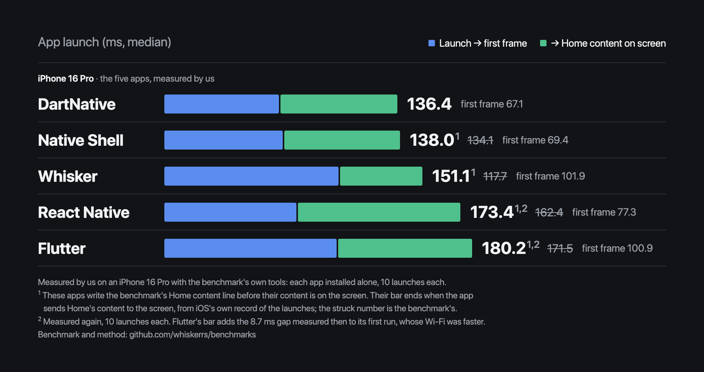

# Frameworks comparison: the shop app

The [shop app benchmark](https://github.com/whiskerrs/benchmarks), made by
the authors of the Whisker framework, builds the same app with many
frameworks and measures each one on an iPhone with the same tools. The app
is a small clothing shop: a Home screen, collections, product pages, search
and a cart.

**Every app the benchmark has built, and all its results, are in its own
repository:** React Native, Flutter, Whisker, Native Shell, NativeScript,
Exact, UIKit, SwiftUI and NativePHP, each in
[`apps/`](https://github.com/whiskerrs/benchmarks/tree/main/apps), with the
numbers in
[`results/`](https://github.com/whiskerrs/benchmarks/tree/main/results).
Each of its apps was written by an AI from the same prompt. This folder
holds the apps we compare DartNative with, and DartNative's own.

## The apps in this folder

| Folder | Framework | Written by |
| --- | --- | --- |
| [`dartnative/`](dartnative/) | DartNative | the DartNative team, from the benchmark's specification and its Flutter app |
| [`flutter/`](flutter/) | Flutter | the benchmark (its `apps/flutter`) |
| [`react-native/`](react-native/) | React Native | the benchmark (its `apps/react-native`) |
| [`nsh/`](nsh/) | Native Shell | the benchmark (its `apps/nsh`) |
| [`whisker/`](whisker/) | Whisker | the benchmark (its `apps/whisker`) |

- **The benchmark's apps** are copied unchanged from its repository at
  commit `635ec66`. Each folder has the benchmark's MIT license
  (Copyright (c) 2026 itome) in `LICENSE`, and its `BUILD.md` says how to
  build it.
- **DartNative's app** has the same screens, layout, data and requests as
  the others, and the element names the benchmark's test runner looks for.
  The benchmark also has a DartNative app of its own, written by its AI
  from the same prompt, in its
  [`apps/dartnative`](https://github.com/whiskerrs/benchmarks/tree/main/apps/dartnative).
  The one here is ours.

The benchmark, its prompt, its test runner and its measuring tools are the
benchmark authors' work, under the same MIT license.

## Why these frameworks

The benchmark covers more frameworks than this folder. We picked these for
the following reasons:

- **Flutter**: DartNative and Flutter belong to the same Dart community,
  and DartNative apps are written the way Flutter apps are.
- **Native Shell**: it has the fastest launch in the results published in
  the benchmark's repository, measured on an iPhone 12.
- **Whisker**: its authors made the benchmark.
- **React Native**: people in the React Native community asked us to
  include it.

The other frameworks are in the
[benchmark's repository](https://github.com/whiskerrs/benchmarks), with
their results. Its list of frameworks may be updated over time.

## Launch: the five apps, with the benchmark's tools



| App | First frame, median ms | Home content, median ms | App size |
| --- | ---: | ---: | ---: |
| DartNative | **67.1** | **136.4** | 13.9 MB |
| Native Shell | 69.4 | ~~134.1~~ 138.0¹ | 27.6 MB |
| React Native² | 77.3 | ~~162.4~~ 173.4¹ | 23.8 MB |
| Flutter² | 100.9 | ~~171.5~~ 180.2¹ | 16.6 MB |
| Whisker | 101.9 | ~~117.7~~ 151.1¹ | **5.6 MB** |

**About the Home content column.** The benchmark takes Home content as the
moment each app writes a log line, `SHOPBENCH home_ready`, and asks every
app to write it when Home first displays its loaded content. For a fair
comparison, that line has to mark the same moment in every app: when
Home's content reaches the screen. Looking at the recordings, we found that
only DartNative writes it at that moment; the other four write it before
their content is on the screen. For those four, we strike the benchmark's
number and put beside it the moment the app actually sends Home's content
to the screen, read from iOS's own record in the same recordings. Where
each app writes it:

- **DartNative** writes it just after Home's content is on the screen, so
  its number is the benchmark's. Code:
  [`dartnative/lib/screens/home.dart`, line 45](dartnative/lib/screens/home.dart#L45),
  in this folder.
- ¹ The other four write it before their content is on the screen:
  - **Native Shell** by a median of 4.1 ms, in 7 of 10 launches; at or
    just after it in the other 3. Code:
    [`apps/nsh/src/pages/home.rs`, lines 35 to 40](https://github.com/whiskerrs/benchmarks/blob/635ec665ac73439ccc04f518121b1ab7776fa631/apps/nsh/src/pages/home.rs#L35-L40).
  - **Whisker** by 33 to 38 ms, in every launch. Code:
    [`apps/whisker/src/screens/home.rs`, lines 167 to 173](https://github.com/whiskerrs/benchmarks/blob/635ec665ac73439ccc04f518121b1ab7776fa631/apps/whisker/src/screens/home.rs#L167-L173).
  - **React Native** by a median of 12.2 ms, in every launch. Code:
    [`apps/react-native/src/screens/HomeScreen.tsx`, lines 26 to 32](https://github.com/whiskerrs/benchmarks/blob/635ec665ac73439ccc04f518121b1ab7776fa631/apps/react-native/src/screens/HomeScreen.tsx#L26-L32).
  - **Flutter** by a median of 8.7 ms, in every launch. Code:
    [`apps/flutter/lib/screens/home.dart`, line 45](https://github.com/whiskerrs/benchmarks/blob/635ec665ac73439ccc04f518121b1ab7776fa631/apps/flutter/lib/screens/home.dart#L45),
    which has
    [`ios/Runner/AppDelegate.swift`, line 13](https://github.com/whiskerrs/benchmarks/blob/635ec665ac73439ccc04f518121b1ab7776fa631/apps/flutter/ios/Runner/AppDelegate.swift#L13)
    write the line.
- ² **React Native** and **Flutter** were measured a second time, 10
  launches each with the same tools, because the recordings of their first
  run were not kept. React Native's row is that second run. Flutter's row
  keeps its first run, with the 8.7 ms gap measured in the second run
  added (171.5 + 8.7): in the second run, slower Wi-Fi connections raised
  both its numbers, to 202.5 and 210.7, with no change in the app.

More in [When each app writes `home_ready`](#when-each-app-writes-home_ready).

DartNative is first to show its first frame and first to show Home's
content. Whisker's app is the smallest.

How these were measured:

- **The benchmark's own tools**, unchanged apart from the one line that adds
  DartNative's app to their list of apps (step 2 below). Each app is
  installed alone, rests 3 minutes, is launched once (that launch is thrown
  away), then is launched 10 times, and is uninstalled before the next app.
- **First frame**: Instruments' App Launch, from the process starting to the
  app's first frame on screen.
- **Home content**: from the process starting to the line
  `SHOPBENCH home_ready`, which the benchmark asks each app to write when
  Home first shows its content, read from the same recording.
- **App size**: the bytes of the built app.
- **One round, the launch only.** The benchmark's full protocol runs three
  rounds and also a walk through the app, for memory, scrolling, CPU and
  energy.
- **The phone**: an iPhone 16 Pro on iOS 27.2.1, connected to the Mac by
  cable. The benchmark's own results come from an iPhone 12, so compare
  these numbers with each other, not with its.
- **The builds**: each app from its folder here, as its `BUILD.md`
  describes. DartNative's was built with a build of DartNative 1.7.0 made
  before its release.

### When each app writes `home_ready`

The benchmark asks each app to write `SHOPBENCH home_ready` when Home first
displays its loaded content. Each app writes the line from its own code, and
the script takes the moment the line is written, so where an app writes it
moves its Home content number.

The same recordings also hold iOS's own record of each update an app sends
to the screen. Medians of the same 10 launches, in ms from the process
starting (React Native and Flutter: their second run):

| App | Line written (the benchmark's number) | Home's content sent to the screen |
| --- | ---: | ---: |
| DartNative | 136.4 | **136.1** |
| Native Shell | 134.1 | 138.0 |
| Whisker | 117.7 | 151.1 |
| React Native | 162.4 | 173.4 |
| Flutter | 202.5 | 210.7 |

- **DartNative** writes the line just after Home's content is sent to the
  screen, and **Native Shell** as it starts sending it.
- **React Native** writes it from a React effect once Home's data is in,
  4 to 10 ms before the app starts sending the content to the screen, in
  every launch.
- **Flutter** writes it from a post-frame callback, as DartNative does. In
  Flutter that callback runs once the frame is built, before Flutter's
  drawing thread has drawn it: 3.5 to 9 ms before the drawing ends, in
  every launch.
- **Whisker** writes it when its Home content is created in its own
  component tree, before the views are drawn: 33 to 38 ms before the content
  is sent to the screen, in all 10 launches. The line is in the benchmark's
  repository at
  [`apps/whisker/src/screens/home.rs`, lines 167 to 173](https://github.com/whiskerrs/benchmarks/blob/635ec665ac73439ccc04f518121b1ab7776fa631/apps/whisker/src/screens/home.rs#L167-L173),
  and the same in this folder's
  [`whisker/src/screens/home.rs`](whisker/src/screens/home.rs#L167-L173):

  ```rust
  #[component]
  fn home_content(data: HomeData) -> Element {
      on_mount(|| {
          if !HOME_READY_LOGGED.swap(true, Ordering::SeqCst) {
              shop_native::log_line("SHOPBENCH home_ready");
          }
      });
  ```

  The benchmark's own results note that React Native and Whisker write the
  line about one frame before the content is painted.

Measured by when Home's content is sent to the screen, DartNative is first.

### What is in DartNative's 13.9 MB

| Part | Size |
| --- | ---: |
| The engine that runs Dart | 4.2 MB |
| DartNative's native layer and the app's plugins | 4.0 MB |
| The app's own code, compiled | 2.5 MB |
| Two icon fonts DartNative includes (this app uses neither) | 2.0 MB |
| Text data used by the engine | 0.9 MB |
| Other files | 0.3 MB |

Running Dart costs the engine, 4.2 MB. The rest is what every app carries:
native code, its own code, fonts and data.

For scale, apps people use every day are far larger. On an iPhone, the App
Store lists X at 713.0 MB, Instagram at 674 MB, WhatsApp at 382.2 MB and
Telegram at 168.2 MB. In apps of that kind, a few MB of framework make no
practical difference.

## Running it yourself

Needs a Mac with Xcode 27.2, an iPhone connected by cable and on the same
Wi-Fi network as the Mac, Python 3, and the tools each app's `BUILD.md`
lists. DartNative's app runs on DartNative's free trial, or with a license
(the Community license is free).

1. Clone the benchmark and build its test runner, as its `tools/README.md`
   describes, with your signing team:

   ```bash
   git clone https://github.com/whiskerrs/benchmarks
   cd benchmarks/tools/runner
   xcodegen generate
   xcodebuild build-for-testing -project ShopBenchRunner.xcodeproj -scheme ShopBenchRunner \
     -destination 'generic/platform=iOS' -derivedDataPath build/device \
     -allowProvisioningUpdates DEVELOPMENT_TEAM=<your team id>
   cd ../..
   ```

2. Add DartNative's app to `APPS` in `tools/measure.py`:

   ```python
   "dartnative": ("dartnative", RUNS / "dartnative/build/ios/iphoneos/Runner.app"),
   ```

3. Build each app into `~/shopbench-runs/<folder>/`, where the script reads
   them, as its `BUILD.md` says. For DartNative's:

   ```bash
   cp -R <this folder>/dartnative ~/shopbench-runs/dartnative
   (cd ~/shopbench-runs/dartnative && dn pub get && dn build ios --release)
   ```

   `--dart-define=SHOPBENCH_DIAG=true` makes the app print a few extra
   timing lines. Leave it out when measuring: the benchmark allows one log
   line in a measured app.

4. Measure. With no other flags, the script runs the benchmark's full
   protocol (three rounds, each app installed alone, launches and the walk
   through the app):

   ```bash
   python3 tools/measure.py --udid <iPhone id> --host <the Mac's IP> \
     --apps dartnative,flutter,react-native,nsh,whisker
   ```

   For the launch only, add
   `--launch-runs 10 --journey-runs 0 --instruments ""`.
