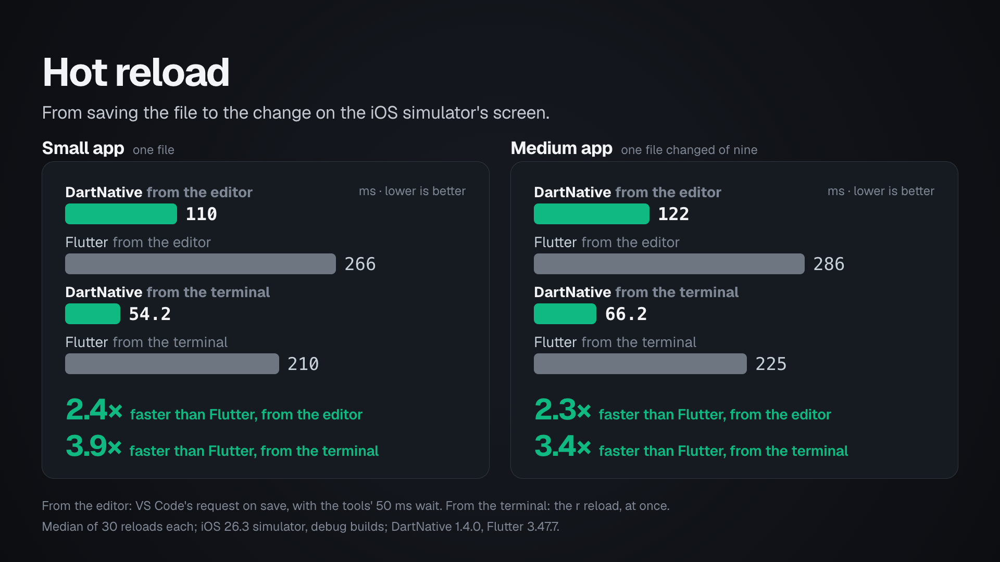

# Hot reload

Hot reload is the wait between saving a file and seeing the change in the
running app, and a developer goes through it hundreds of times a day. This
benchmark measures that wait in DartNative and Flutter: the same screens in
each, one line changed and saved again and again, timed from the save to the
change on the screen.

On the iOS simulator, with the file saved in an editor, DartNative's reload
reached the screen in 110 ms on the small app and 122 ms on the medium one;
Flutter's took 266 and 286 ms, 2.4 and 2.3 times as long. Reloaded from the
terminal, with no wait, DartNative's took 54.2 and 66.2 ms and Flutter's
210 and 225 ms, 3.9 and 3.4 times as long. Each number is the median of 30
reloads.

**Status: the iOS simulator.** The numbers come from the iOS simulator on a
Mac, with debug builds, as hot reload runs. DartNative was measured with
its 1.4.0 SDK.



## What is compared

| App | Version | Runs with |
| --- | --- | --- |
| DartNative | 1.4.0 | `dn run` |
| Flutter | 3.47.7, the latest stable (Dart 3.13.5) | `flutter run` |

Two apps, the same in both frameworks:

- **The small app** is one file: an app bar titled "Hot reload" over a list
  of 40 cards, each with a label. The cards' colour comes from one constant,
  `cardColor`, and each reload changes it.
- **The medium app** is a contacts screen built from nine files: an app bar
  over a list whose first item is a header (a title and three small panels
  with counts) and whose 40 rows each show an avatar with initials, a name,
  a role and a trailing chevron. The screen, the list, the header, its
  panels and the row each have a file of their own, beside the data, and
  each reload changes `rowColor` in the row's file, one file of the nine.

The apps are in [`dartnative/`](dartnative/) and [`flutter/`](flutter/): the
small one in `lib/main.dart`, the medium one in `lib/medium/`. The two
frameworks' files are the same apart from the import of the framework, how
each app starts, and the one call that reads a colour's value.

Where the two differ, each doing what it does by default:

- **The list.** DartNative's `ListView.builder` builds all 40 rows. Flutter's
  builds only the rows on screen and a little beyond.
- **The bar** is each framework's usual one: the platform's navigation bar
  in DartNative, Material's app bar in Flutter.
- **Each in its standard setup**: debug builds, as `dn run` and `flutter run`
  start them.

## How it is measured

- **From the save to the screen.** The timer starts when the new colour is
  written to the file, and stops at the first frame of the simulator's own
  screen recording (`xcrun simctl io recordVideo`) that shows the new colour
  on the cards or rows. The recording keeps a frame for every change of the
  screen, with its time; it is placed on the Mac's clock at the moment the
  simulator reports that the recording has started, the same way for both
  apps.
- **Two ways to start a reload**, both timed from the save:
  - **From the editor**: the app runs under the tool's daemon
    (`dn run --machine`, `flutter run --machine`), as editors run it, and
    the save is followed by the request VS Code sends when a Dart file is
    saved, `app.restart` with `debounce: true`. With it, both tools wait
    50 ms before they start, so that files saved together reload together.
  - **From the terminal**: the app runs under `dn run` or `flutter run`, and
    the save is followed at once by the reload that `r` starts in the
    terminal (the script sends it as the signal that does the same,
    SIGUSR1). There is no wait.
- **Sessions.** Each session starts the app, makes 3 warm-up reloads, then
  10 measured reloads 3 seconds apart, each to a new colour. Every
  combination of app, framework and way of reloading ran 3 sessions, all in
  one sitting: three rounds, each running every combination once, in an
  order that changed from round to round. Each number below comes from 30
  reloads: the median, and the p90, the time 90% of the reloads did not
  exceed.
- **Nothing else running**: no other app on the simulator, and no Android
  emulator or other build on the Mac.
- **The apps' own report.** After each frame, each app sends the colour it
  has just drawn to the measuring script, with a request to the Mac from a
  post-frame callback (in the medium app, from the first row). The script
  waits for it before the next reload. The time measured comes from the
  recording, not from this request. As a check, the new colour reached the
  screen after each app's report, never before.
- **The machine**: a 13-inch MacBook Pro with Apple M1 and 16 GB of memory,
  macOS 27.0.1, Xcode 27.2 (27B5028f), the iOS 26.3 simulator on an iPhone
  17 Pro.

## Results

iOS 26.3 simulator, iPhone 17 Pro, on a MacBook Pro with Apple M1. 30
reloads for each row, from 3 sessions.

### Small app: one file

| App | Reload | Save to screen, median ms (lower is better) | p90, ms (lower is better) |
| --- | --- | ---: | ---: |
| DartNative | from the editor | 110 | 125 |
| DartNative | from the terminal | 54.2 | 65.2 |
| Flutter | from the editor | 266 | 283 |
| Flutter | from the terminal | 210 | 243 |

### Medium app: one file changed of nine

| App | Reload | Save to screen, median ms (lower is better) | p90, ms (lower is better) |
| --- | --- | ---: | ---: |
| DartNative | from the editor | 122 | 201 |
| DartNative | from the terminal | 66.2 | 77.8 |
| Flutter | from the editor | 286 | 322 |
| Flutter | from the terminal | 225 | 257 |

### The tools' own timing

Both tools also time each reload themselves. The medians of the 60 reloads
of both ways of starting them, which give the same times here, since the
tools start counting after the wait:

| App | Libraries reloaded | Compile, ms | Reload, ms | Reassemble, ms | The tool's total, ms |
| --- | --- | ---: | ---: | ---: | ---: |
| DartNative, small app | 1 of 129 | 5 | 17 | 7 | 38 |
| Flutter, small app | 1 of 754 | 16.5 | 70 | 50 | 158 |
| DartNative, medium app | 4 of 137 | 5 | 19.5 | 14 | 48 |
| Flutter, medium app | 4 of 762 | 19 | 79 | 63 | 177 |

Compile is the changed libraries compiled; reload is the Dart VM taking in
the new code; reassemble is the app rebuilding its screen. In the medium
app, the changed file and the three files that depend on it on the way up
to `main` are reloaded. Save to screen adds the save reaching the tool, the
wait when the reload comes from the editor, and the new frame reaching the
screen.

**The wait.** From the editor, both tools wait the same 50 ms before they
start, so that files saved together reload together; it is part of both
"from the editor" numbers.

Flutter 3.41.2, the previous stable release, measured the same way in an
earlier sitting, took 247 ms (p90 273) on the small app from the editor,
about the same as 3.47.7.

## Why DartNative is faster

- **Fewer libraries to reload.** DartNative's framework comes precompiled
  with the SDK, so the program the Dart VM reloads holds 129 libraries for
  the small app where Flutter's holds 754, and the reload step takes 17 ms
  against 70 (19.5 against 79 in the medium app).
- **A rebuild that updates the native views.** On reload the app rebuilds
  its screen. In DartNative the rebuild sets the new colour on the native
  views directly, and the system draws them. Reassemble takes 7 ms against
  Flutter's 50 (14 against 63 in the medium app).
- **The system shows the change sooner.** After each app reported its new
  frame, the colour reached the screen 16 ms later in DartNative and 45 ms
  later in Flutter (medians over both apps). The system draws the native
  views as soon as they change; Flutter's frame still has to be rasterised
  and handed over.

Flutter's reload costs what it does because the Dart VM reloads the state
of all the app's libraries, most of them Flutter's own, then the whole
widget tree rebuilds and lays out again, and a new frame is rasterised
before the system can show it.

## Limits

- **A simulator, not phones.** The simulator runs on the Mac's processor,
  and the tools reach it without a cable or a network. On a phone every
  reload also crosses USB or Wi-Fi, and the numbers will be different.
- **Small apps and a one-line change.** Even the medium app has nine files;
  larger apps, and changes that touch many files, take longer in both
  frameworks.
- **Debug builds, by nature.** Hot reload exists only in debug builds, so
  these numbers say nothing about how fast the apps run once released.
- **The lists differ.** DartNative builds all 40 rows, where Flutter builds
  the rows on screen, so DartNative's rebuild covers more rows.
- **A busy moment counts.** The Mac had its everyday apps open, and the
  numbers keep every session. One DartNative session (the medium app, from
  the editor) was slower than the other two, at a median of 145 ms against
  118 and 128 ms, with reloads up to 217 ms; it is why that row's p90 is
  201 ms.
- **The 50 ms wait** is inside both numbers from the editor, as described
  above.
- **The clock.** Each recording is placed on the Mac's clock once, when the
  simulator reports that it has started. An error in that moment moves all
  of a session's reloads together, the same way for both apps; the check
  above shows the colour never on screen before an app's report.

## Running it again

Needs a Mac with Xcode and an iOS simulator, Python 3 and ffmpeg;
DartNative's SDK (`dn`) and Flutter. Boot one simulator and keep it on
screen in the Simulator app, quit other heavy work, then run these from
this folder:

```bash
(cd dartnative && dn pub get)
(cd flutter && flutter pub get)

# Each line runs 3 sessions of 3 warm-up and 10 measured reloads.
python3 tool/measure.py dartnative --app small --route editor
python3 tool/measure.py dartnative --app small --route terminal
python3 tool/measure.py flutter --app small --route editor
python3 tool/measure.py flutter --app small --route terminal
# ... and the same four with --app medium

python3 tool/summarize.py                # the tables above, from results/
python3 chart.py README.md charts/save_to_screen.png --footer "$FOOTER"
```

The numbers on this page come from those eight lines run with
`--sessions 1`, three times over, in an order that changed each time.
`tool/measure.py` also takes `--device`, `--reloads`, `--warmups` and
`--gap`, and `--dn` or `--flutter` for a tool that is not the one on
`PATH`; usage is at the top of each script. Every session leaves its
numbers, the tool's output and the screen recording in `results/`, and
`python3 tool/pixels.py results/<session>.json` shows each reload found in
its recording.

The chart's footer:

```bash
FOOTER="From the editor: VS Code's request on save, with the tools' 50 ms wait. From the terminal: the r reload, at once.\nMedian of 30 reloads each; iOS 26.3 simulator, debug builds; DartNative 1.4.0, Flutter 3.47.7."
```
