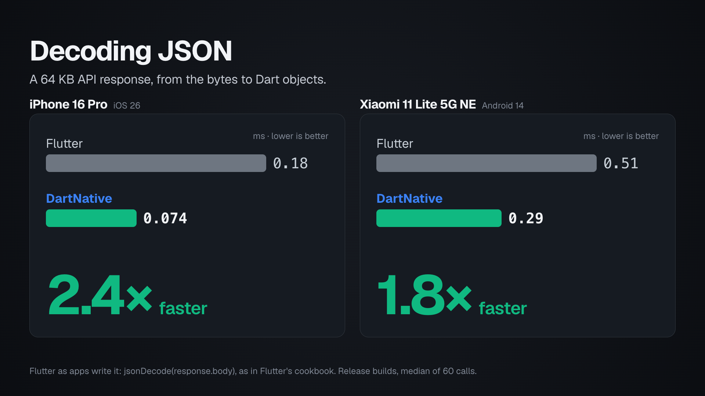
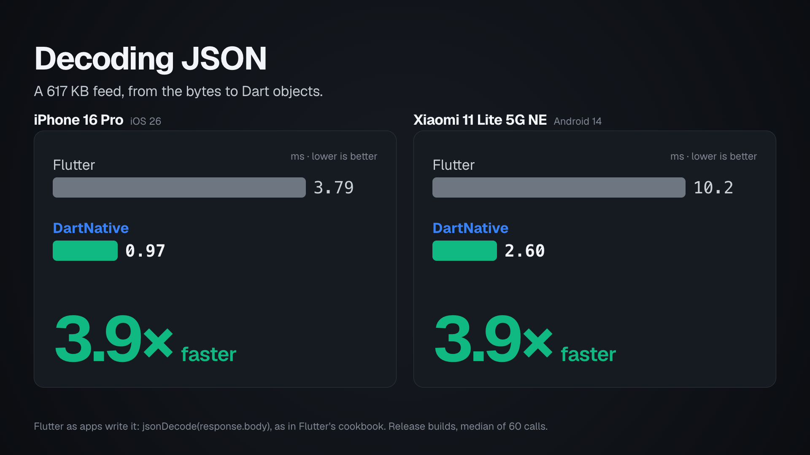
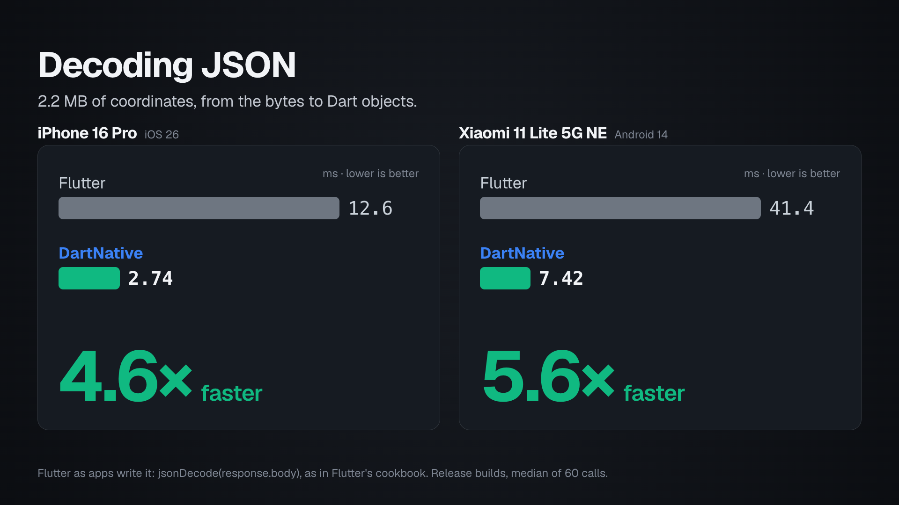
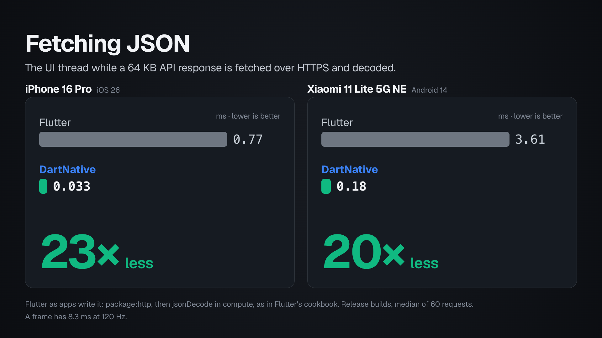
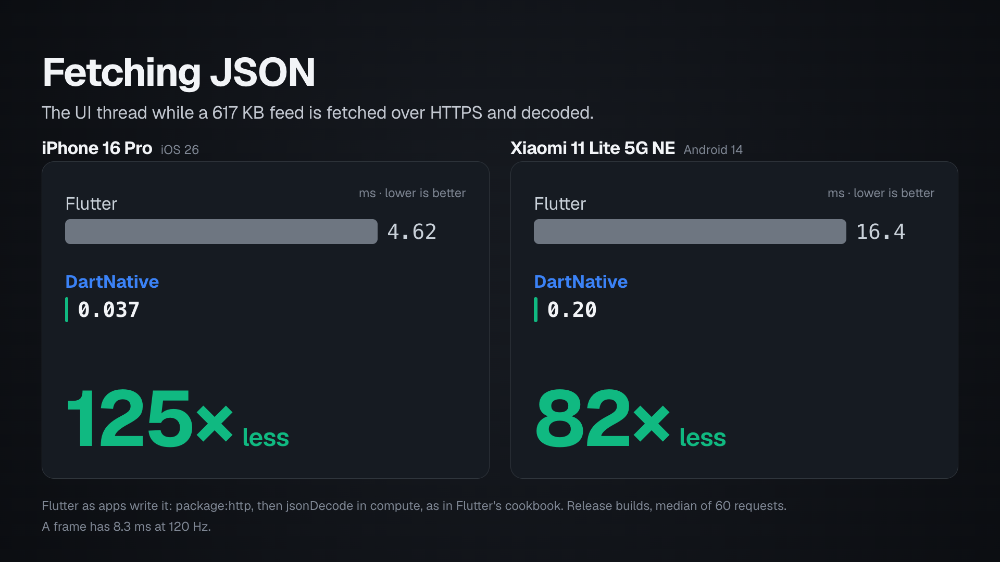
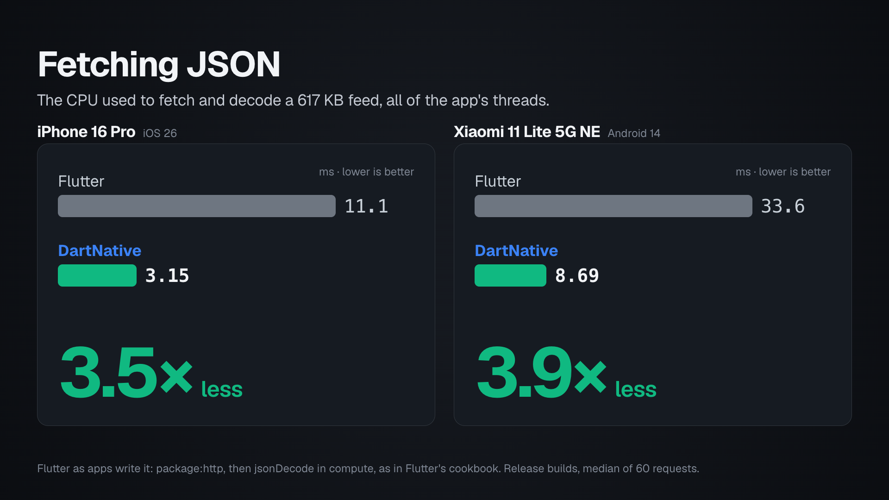

# Fetching and decoding JSON

Almost every app fetches JSON and turns it into objects. This benchmark
measures that work the way an app does it, from the request to the Dart
objects, on the same phones as the scrolling benchmark.

**Status: release builds.** The numbers come from release builds of the
two apps in this folder: `flutter/` runs Flutter's routes and `dartnative/`
runs DartNative's, and both time them with the same code
(`shared/bench_core.dart`).

## What is compared

- **Flutter, as apps write it**, the way Flutter's cookbook shows:
  `package:http` fetches the response, `response.body` decodes it to a
  String, and `jsonDecode` turns it into maps and lists, inside `compute`
  when the payload is large. Timed from the bytes:
  `jsonDecode(utf8.decode(bytes))`.
- **Flutter, best case**: `utf8.decoder.fuse(json.decoder).convert(bytes)`,
  Dart's fastest decoder in the standard library. Dart's VM recognizes this
  exact combination and reads the UTF-8 bytes directly, with no String in
  between. It returns the same objects as `jsonDecode`. For fetching, the
  best case is `package:http` with this decoder on a background isolate.
  - Its strengths: it comes with Dart and needs nothing else, and it is
    1.6 to 3.1 times faster than `jsonDecode` on JSON made of objects and
    strings (the API response and the feed below).
  - Its weaknesses: few apps use it. Flutter's cookbook, `package:http`'s
    examples and most answers online show `jsonDecode(response.body)`, and
    this form is hard to find. A shorter way to reach it has been proposed
    to the Dart team but is not in the SDK yet
    ([dart-lang/sdk#55522](https://github.com/dart-lang/sdk/issues/55522)).
    It is slightly slower than `jsonDecode` on JSON made of numbers (the
    coordinates below), and the Dart team notes it is slow on strings with
    escapes. It still builds every map and list, which is most of the
    work, and it keeps the UI thread free only when the app starts a
    background isolate for each call.
- **Flutter's platform clients**: `cupertino_http` (NSURLSession) on iOS
  and `cronet_http` (Cronet) on Android, the clients Flutter recommends
  for the platform's own networking, with the decoder above.
- **DartNative**: for fetching, `getJson` from the `dartnative_http`
  plugin; for decoding, `jsonDecodeNative` on the calling isolate and
  `jsonDecodeInBackground` on a background isolate.

Every route returns the same objects as `jsonDecode`: `Map<String,
dynamic>`, `List<dynamic>`, `String`, `int`, `double`, `bool`, in the
document's key order. Each result is checked equal to `jsonDecode`'s
before it is timed.

## How it is measured

- Release builds, on an iPhone 16 Pro (iOS 26) and a Xiaomi 11 Lite 5G NE
  (Android 14); on Android both apps are compiled ahead of time the same
  way.
- **Decoding**: from the response bytes to the Dart objects. Each route
  runs once per round in a new order, 30 rounds after 3 warm-up rounds, in
  two runs of each app; the number is the median of the 60 calls.
- **Fetching**: the same files over HTTPS from a CDN (GitHub's, gzip,
  HTTP/2), each route fetching and decoding to Dart objects, 30 rounds in a
  new order each, in two runs of each app, one app after the other. Each
  request records three numbers:
  - **UI thread busy**: how long the thread that runs the app's Dart code
    was busy. A busy UI thread is what drops frames: a frame has 8.3 ms at
    120 Hz.
  - **CPU used**: the CPU time of the whole app, including the moment right
    after the call, when a background isolate ends.
  - **Time to the data**: from the call until the objects are back.
- A phone sets its CPU's speed from the app's recent work, so before each
  call the CPU is brought to full speed: neither app is measured on a
  slower clock. One route runs the same code in both apps (Dart's own
  `dart:io` client with `jsonDecode`). It shows whether every run had the
  same conditions, and a run that did not is measured again.
- The payloads are the standard JSON benchmark files: `github_events.json`
  (64 KB, an API response), `twitter.json` (617 KB, a feed),
  `citm_catalog.json` (1.7 MB, a catalog) and `canada.json` (2.2 MB of
  coordinates).

## How DartNative gets there

- **The phone's own networking.** `dartnative_http` runs requests on
  NSURLSession on iPhone and OkHttp on Android. The response body is read
  straight into native memory and reaches Dart without a copy.
- **A native decoder.** DartNative parses the bytes in native code
  (yyjson) into a compact layout, and Dart builds the objects from it in
  one pass, making each repeated key once. No String is made from the
  body.
- **Nothing on the UI thread.** `getJson` runs the whole request and the
  decoding on a background isolate that DartNative keeps ready: the UI
  thread sends one message and gets the objects back, without a copy. The
  background isolate waits for the response on its own thread, so the UI
  thread sleeps while the network works, and an idle app is not woken at
  all.
- **No time lost along the way.** The background isolate starts from the
  native functions the app has already looked up, instead of loading them
  again. On iPhone, the networking runs at the priority of work the user
  is waiting for. On Android, the networking code is compiled when the app
  is installed, rather than interpreted the first time it runs.

## At a glance













## iPhone 16 Pro, API response

`github_events.json`, 64 KB.

| App | On the calling isolate, ms (lower is better) | In the background, ms (lower is better) |
| --- | ---: | ---: |
| Flutter, as apps write it | 0.18 | 0.25 |
| Flutter, best case | 0.095 | 0.16 |
| DartNative | 0.074 | 0.14 |

## Android phone, API response

| App | On the calling isolate, ms (lower is better) | In the background, ms (lower is better) |
| --- | ---: | ---: |
| Flutter, as apps write it | 0.51 | 0.95 |
| Flutter, best case | 0.31 | 0.75 |
| DartNative | 0.29 | 0.57 |

## iPhone 16 Pro, Feed

`twitter.json`, 617 KB.

| App | On the calling isolate, ms (lower is better) | In the background, ms (lower is better) |
| --- | ---: | ---: |
| Flutter, as apps write it | 3.79 | 3.43 |
| Flutter, best case | 1.23 | 1.58 |
| DartNative | 0.97 | 1.19 |

## Android phone, Feed

| App | On the calling isolate, ms (lower is better) | In the background, ms (lower is better) |
| --- | ---: | ---: |
| Flutter, as apps write it | 10.2 | 10.3 |
| Flutter, best case | 3.40 | 5.03 |
| DartNative | 2.60 | 3.50 |

## iPhone 16 Pro, Numbers

`canada.json`, 2.2 MB, almost all of it decimal numbers.

| App | On the calling isolate, ms (lower is better) | In the background, ms (lower is better) |
| --- | ---: | ---: |
| Flutter, as apps write it | 12.6 | 15.5 |
| Flutter, best case | 13.8 | 15.1 |
| DartNative | 2.74 | 7.32 |

## Android phone, Numbers

| App | On the calling isolate, ms (lower is better) | In the background, ms (lower is better) |
| --- | ---: | ---: |
| Flutter, as apps write it | 41.4 | 54.3 |
| Flutter, best case | 44.5 | 55.0 |
| DartNative | 7.42 | 23.5 |

"In the background" means `compute` for Flutter as apps write it,
`Isolate.run` around the fused decoder for the best case, and
`jsonDecodeInBackground` for DartNative. Flutter's way also keeps the UI
thread busy turning the body into a String before the background isolate
starts: for the feed, 1.24 ms on the iPhone and 3.10 ms on the Android
phone, where DartNative's call takes 0.061 ms and 0.30 ms. For a small
payload, handing the work to another isolate costs more than the decoding
itself, whatever the decoder.

## iPhone 16 Pro, Fetch an API response

`github_events.json` over HTTPS, 64 KB, fetched and decoded to Dart objects.

| App | UI thread busy, ms (lower is better) | CPU used, ms (lower is better) | Time to the data, ms (lower is better) |
| --- | ---: | ---: | ---: |
| Flutter, http + compute | 0.77 | 1.35 | 35.2 |
| Flutter, best case | 0.72 | 1.27 | 34.7 |
| Flutter, cupertino_http | 0.29 | 1.41 | 29.5 |
| DartNative | 0.033 | 0.98 | 32.3 |

## Android phone, Fetch an API response

| App | UI thread busy, ms (lower is better) | CPU used, ms (lower is better) | Time to the data, ms (lower is better) |
| --- | ---: | ---: | ---: |
| Flutter, http + compute | 3.61 | 5.56 | 42.8 |
| Flutter, best case | 3.54 | 5.39 | 41.8 |
| Flutter, cronet_http | 2.37 | 5.77 | 38.7 |
| DartNative | 0.18 | 3.21 | 39.6 |

## iPhone 16 Pro, Fetch a feed

`twitter.json` over HTTPS, 617 KB, fetched and decoded to Dart objects.

| App | UI thread busy, ms (lower is better) | CPU used, ms (lower is better) | Time to the data, ms (lower is better) |
| --- | ---: | ---: | ---: |
| Flutter, http + compute | 4.62 | 11.1 | 49.2 |
| Flutter, best case | 3.35 | 8.95 | 47.1 |
| Flutter, cupertino_http | 2.25 | 8.78 | 41.8 |
| DartNative | 0.037 | 3.15 | 43.2 |

## Android phone, Fetch a feed

| App | UI thread busy, ms (lower is better) | CPU used, ms (lower is better) | Time to the data, ms (lower is better) |
| --- | ---: | ---: | ---: |
| Flutter, http + compute | 16.4 | 33.6 | 73.4 |
| Flutter, best case | 13.8 | 28.9 | 67.6 |
| Flutter, cronet_http | 13.6 | 36.2 | 72.2 |
| DartNative | 0.20 | 8.69 | 65.4 |

## iPhone 16 Pro, Fetch a catalog

`citm_catalog.json` over HTTPS, 1.7 MB, fetched and decoded to Dart objects.

| App | UI thread busy, ms (lower is better) | CPU used, ms (lower is better) | Time to the data, ms (lower is better) |
| --- | ---: | ---: | ---: |
| Flutter, http + compute | 7.49 | 19.8 | 52.0 |
| Flutter, best case | 3.74 | 15.7 | 46.4 |
| Flutter, cupertino_http | 2.88 | 16.3 | 43.4 |
| DartNative | 0.043 | 7.10 | 43.3 |

## Android phone, Fetch a catalog

| App | UI thread busy, ms (lower is better) | CPU used, ms (lower is better) | Time to the data, ms (lower is better) |
| --- | ---: | ---: | ---: |
| Flutter, http + compute | 24.5 | 62.5 | 85.7 |
| Flutter, best case | 18.2 | 53.3 | 77.8 |
| Flutter, cronet_http | 31.0 | 72.0 | 127 |
| DartNative | 0.22 | 14.7 | 69.5 |

The UI thread and the CPU do not depend on the network:

- **The API response**: DartNative's UI thread is busy 0.033 ms on the
  iPhone and 0.18 ms on the Android phone, 23 and 20 times less than
  Flutter's way. Its CPU is 1.4 and 1.7 times lower than Flutter's way,
  and 1.3 and 1.7 times lower than the best case.
- **The feed and the catalog**: DartNative's UI thread stays under 0.22 ms,
  where Flutter's way is busy 4.62 to 24.5 ms. Its CPU is 2.8 to 4.3 times
  lower than Flutter's way, and 2.2 to 3.6 times lower than the best case.

The time to the data is mostly the network. One connection's speed changes
from run to run, and within that change the apps are level. On the 2.2 MB
file the change was larger than the differences between the apps, so that
file is not given.

Flutter can also run the whole request inside `Isolate.run`. Its UI thread
is then almost free (on the API response, 0.061 ms on the iPhone and
0.27 ms on the Android phone), but every request opens a new connection.
So it uses 1.7 to 2.4 times the CPU of the other routes, and takes about
three times as long to the data: 103 ms against 30 to 35 ms on the iPhone,
108 ms against 39 to 43 ms on the Android phone. The tables leave it out.

## Drawing the charts

Run these from this folder. Each chart shows Flutter as apps write it
against DartNative, and the gain between them; the tables above have every
route.

```bash
A="Flutter, as apps write it"
FA="Flutter as apps write it: jsonDecode(response.body), as in Flutter's cookbook. Release builds, median of 60 calls."
FF="Flutter as apps write it: package:http, then jsonDecode in compute, as in Flutter's cookbook. Release builds, median of 60 requests."
python3 chart.py README.md charts/decode_api.png "On the calling isolate" "API response" "$A" "Decoding JSON" "A 64 KB API response, from the bytes to Dart objects." faster --footer "$FA"
python3 chart.py README.md charts/decode_feed.png "On the calling isolate" Feed "$A" "Decoding JSON" "A 617 KB feed, from the bytes to Dart objects." faster --footer "$FA"
python3 chart.py README.md charts/decode_numbers.png "On the calling isolate" Numbers "$A" "Decoding JSON" "2.2 MB of coordinates, from the bytes to Dart objects." faster --footer "$FA"
python3 chart.py README.md charts/fetch_api_ui_thread.png "UI thread busy" "Fetch an API response" "Flutter, http + compute" "Fetching JSON" "The UI thread while a 64 KB API response is fetched over HTTPS and decoded." less --footer "$FF\nA frame has 8.3 ms at 120 Hz."
python3 chart.py README.md charts/fetch_ui_thread.png "UI thread busy" "Fetch a feed" "Flutter, http + compute" "Fetching JSON" "The UI thread while a 617 KB feed is fetched over HTTPS and decoded." less --footer "$FF\nA frame has 8.3 ms at 120 Hz."
python3 chart.py README.md charts/fetch_cpu.png "CPU used" "Fetch a feed" "Flutter, http + compute" "Fetching JSON" "The CPU used to fetch and decode a 617 KB feed, all of the app's threads." less --footer "$FF"
```
