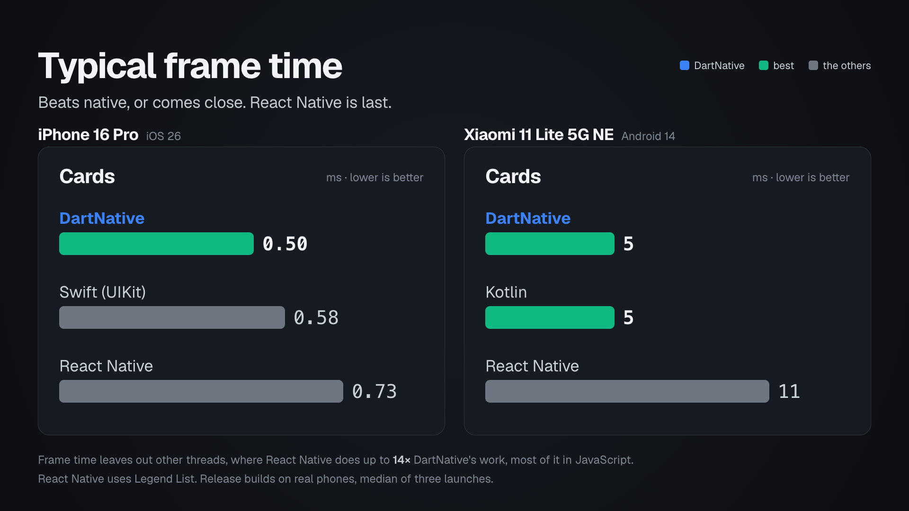
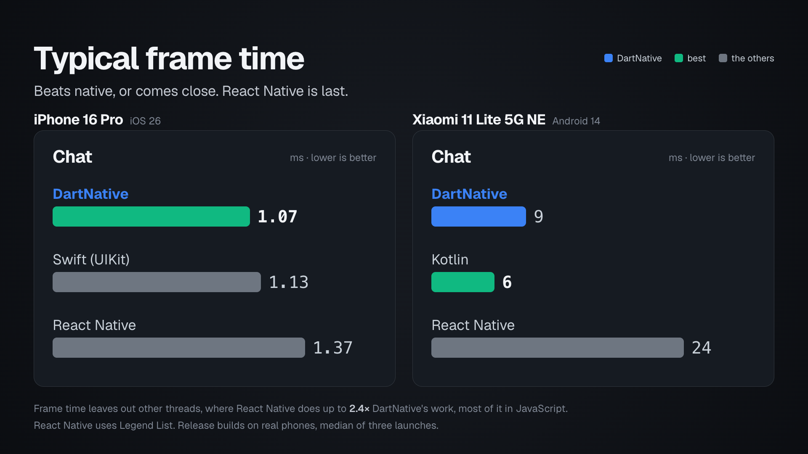
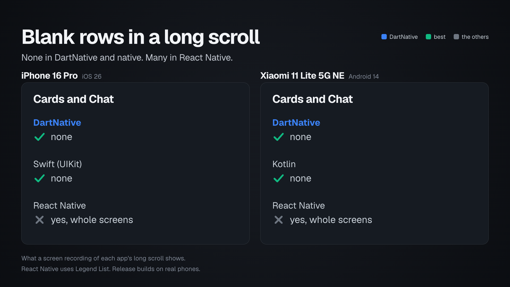
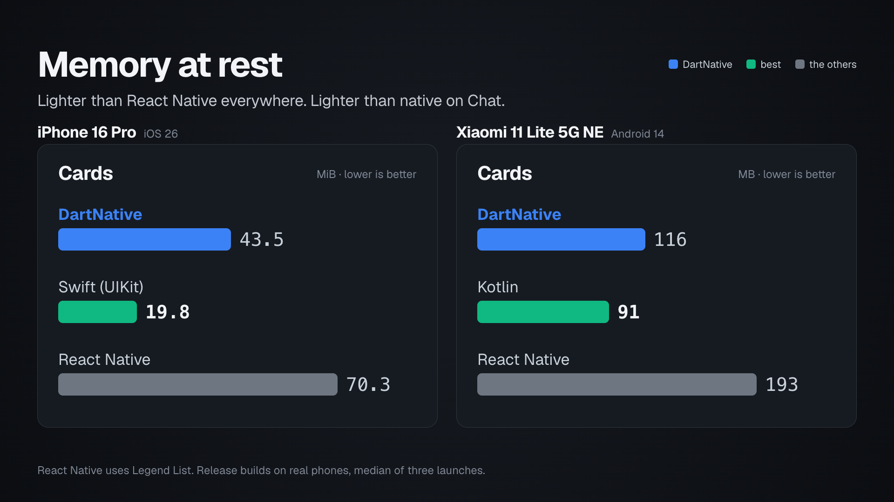
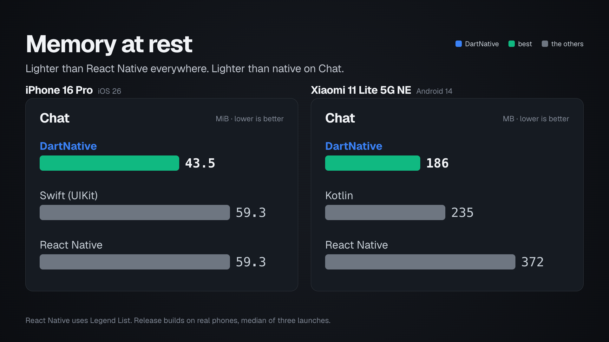
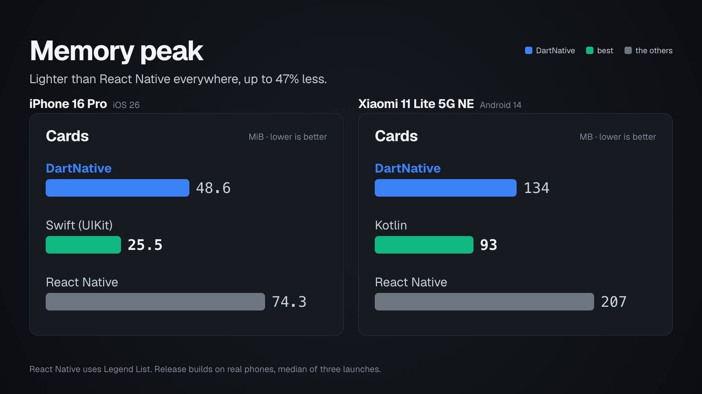
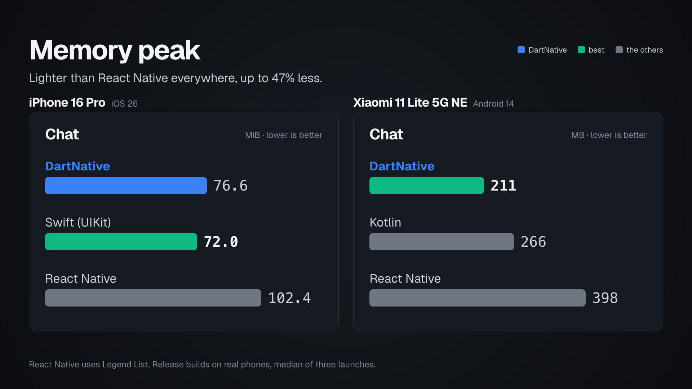

# Results

Every number below names its device, build and setting, and comes from
the operating system's own tools. `METHODOLOGY.md` says how each one was
measured. The charts are drawn from the tables by `harness/chart.py`, so
they cannot drift from them.

## In short

- **Scrolling to a far item.** On both phones and on both screens,
  DartNative brought every target to the top of the list, to within a
  pixel, hundreds of items away, among items it had never measured. Legend List
  missed far targets: on the Android phone's Cards screen its scroll
  stopped 1886 px short of card 400, nearly a screen, and put cards 700
  and 950 186 px low and 257 px high. FlatList landed within a few pixels,
  but took several seconds longer to come to rest on far targets than on
  near ones.
- **Frames on Android.** DartNative's typical frame is shorter than Legend
  List's on both screens: 5 ms against 11 on Cards, 9 against 24 on
  Chat. On Cards the Kotlin app's is the same 5 ms; on Chat it is
  shorter, 6 ms.
- **Frames on the iPhone.** DartNative's typical frame is the shortest of
  the three on both screens: 0.50 ms against the Swift app's 0.58 and
  Legend List's 0.73 on Cards, 1.07 against 1.13 and 1.37 on Chat, with
  stickers animating in the rows. DartNative's scroll was also the least
  late to the screen on both. Inside the driver's flings DartNative left
  one sticker's place empty for a few frames in a Chat run (0.01 to
  0.08 % of the list's area), the other two apps nothing; on the Scroll
  button's long scrolls, the recordings show Legend List passing blank
  rows, whole screens of them, the other two none, on both phones.
- **Memory.** On the Android phone DartNative uses less memory than
  Legend List on Cards (116 MB at rest against 193, 134 at its peak
  against 207) and on Chat (186 against 372, 211 against 398); the Kotlin
  app uses the least on Cards (91 at rest) and more than DartNative on
  Chat (235 at rest, 266 at its peak). On the
  iPhone's Cards screen DartNative is at 44 MiB at rest, Legend List at
  70, the Swift app at 20; on Chat at 44, Legend List and the Swift app
  at 59.

## At a glance

Each chart puts one measure side by side on the two phones, the iPhone on
the left and the Android phone on the right. The sections below have the
tables the numbers come from, and how each was measured.















## How to read the numbers

While a list scrolls, the phone redraws the screen many times a second;
each picture is a **frame**. The Android phone below shows 90 frames a
second, so each frame has 11.1 ms to be ready; the iPhone shows up to
120, 8.3 ms each. A frame that is not ready in time leaves the previous
picture on screen for one more refresh: that is the stutter you see.

- **Frame time, p50**: how long the phone took to make a typical frame,
  in milliseconds, counted from the refresh the frame was meant for. Line
  up every frame of a run from fastest to slowest: p50 is the one in the
  middle, so half the frames were faster. Lower is better. A frame time
  isn't the refresh interval (11.1 ms on Android, 8.3 ms on iPhone,
  16.7 ms at 60 Hz).
  It is how long the work on one frame took: the shorter it is, the more
  time is left before the frame is due, and the more room the app has to
  keep the scroll smooth. On the iPhone the **typical frame time** is the
  same middle frame, timed as Apple's Instruments times the app's
  work on each frame; iOS finishes drawing the frame in a system process
  outside the app. The typical frame is the number compared on both
  phones: it is the measure of smoothness, and the same one on the iPhone
  and on Android.
- **Blank space**: the share of the list's area that showed nothing where
  content should be, counted frame by frame.
- **Memory**: the app's share of the phone's memory (PSS, in MB) at rest
  after the scroll and at its peak during it. Lower is better. On the
  iPhone it is the app's footprint, in MiB, the same two readings. The
  peak is the number the system holds against the app when memory runs
  short.
- On the iPhone, a **hitch** is a frame that reached the screen late, as
  Apple's own scroll metric counts it, and the **frame rate** is how many
  frames a second the screen showed while the list moved.

Unless a section says otherwise, every number is the median of three
launches of the app: the middle one.

The names in the tables: **DartNative** is the DartNative port, a
`FastList`; **Swift (UIKit)** is the iPhone app written in Swift on
UIKit's `UITableView`, "Cards (Swift)" in its own title bar; **Kotlin**
is the Android app written in Kotlin on a `RecyclerView`; **Legend List**
is the Legend List screen of React Native's example app, and FlashList
and FlatList its two other lists.

Legend List stands for React Native, as the fastest of the three lists
its example app offers. The harness builds and runs the FlashList and
FlatList apps the same way, for anyone who wants their numbers, and the
scroll-to tables show them too.

Android also gives the times of the slowest frames (p90 to p99) and the
share of frames it counts as late. They are not compared here. A slow
frame freezes the screen for a refresh in DartNative and Kotlin, and
makes the picture lag behind the finger in React Native, which prepares
its frames a refresh ahead; Android's late count records the freezes and
not the lag. And on this phone the slowest frames follow which processor
cores the system ran the app on. `METHODOLOGY.md`, "Why
Android's slowest frames and late count are not compared", says why; the
harness prints them for every run.

## Android phone, Cards

Xiaomi 11 Lite 5G NE (Android 14, Snapdragon 778G, a 90 Hz display: 11.1
ms per frame), release builds. Each launch scrolls down for 20 s with
Legend List's own `autoscroll.sh` and back up for 20 s with the same
gesture reversed: three launches of each app, `dumpsys gfxinfo` at the
end of each, and the memory from three more launches in which `dumpsys
meminfo` is read once a second through the scroll and once after it (the
highest reading is the peak, the last the rest). The Cards screen is the benchmark's advanced mode, the
same in every app (`METHODOLOGY.md`): the example's own per-card
computation in every card's render, one to forty sentences per card so a
short card sits beside a long one, and a horizontal list of ten images
inside every card. The DartNative app keeps rows built 250 points beyond
each edge of the screen, Legend List's draw distance, and reuses the rows
it lets go (`cacheExtent: 250`, `recycleItems: true`).

| App | Typical frame time, ms (lower is better) | Blank rows in a long scroll | Memory at rest, MB (lower is better) | Memory peak, MB (lower is better) |
| --- | ---: | --- | ---: | ---: |
| DartNative | 5 | none | 116 | 134 |
| Kotlin | 5 | none | 91 | 93 |
| Legend List | 11 | yes, whole screens | 193 | 207 |

More from the same runs, for the reader who wants the shape of the
frames: the slower percentiles and the share of frames Android counts as
late, which the charts do not compare (`METHODOLOGY.md`, "Why Android's
slowest frames and late count are not compared"), and the frames each
launch showed in its 40 s.

| App | Frame time p50 / p90 / p95 / p99, ms | Frames Android counts as late | Frames shown per launch |
| --- | ---: | ---: | ---: |
| DartNative | 5 / 10 / 11 / 11 | 0.14 % | 3,675 to 3,721 |
| Kotlin | 5 / 10 / 10 / 11 | 0.00 % | 3,585 to 3,604 |
| Legend List | 11 / 11 / 12 / 13 | 0.03 % | 3,746 to 3,841 |

Legend List runs the per-card computation on its JavaScript thread, the
DartNative app in Dart on the main thread, the Kotlin app in its bind, on
the main thread: each where that framework builds a card. The memory
moves little during the scroll, from rest to peak 18 MB in DartNative, 14
in Legend List and 2 in Kotlin: each keeps a screen or two of rows and
lets the rest go.

Blank rows show in the Scroll button's long scrolls. What the user sees
during them is on a screen recording of each app's Scroll button, taken
by hand on this phone (below). DartNative and the Kotlin app
draw every card they pass. Legend List shows blank rows, the list's
background with nothing on it, whole screens of it, while a long scroll
moves, and the cards appear once it slows: the "yes, whole screens" in
the table, as on the iPhone. It is not a number, so the blank rows chart
shows it in words.

<table>
  <tr><th>DartNative</th><th>Kotlin</th><th>React Native (Legend List)</th></tr>
  <tr>
    <td width="33%"><video src="https://github.com/user-attachments/assets/a5a4c7b2-84c2-49dc-ae32-b91af8499027" controls><a href="https://github.com/user-attachments/assets/a5a4c7b2-84c2-49dc-ae32-b91af8499027">Watch DartNative</a></video></td>
    <td width="33%"><video src="https://github.com/user-attachments/assets/9cc6f8e8-c336-4387-90ba-f3e0795d1b14" controls><a href="https://github.com/user-attachments/assets/9cc6f8e8-c336-4387-90ba-f3e0795d1b14">Watch Kotlin</a></video></td>
    <td width="33%"><video src="https://github.com/user-attachments/assets/23e31cf9-41e2-428a-bf19-072d36d00ad1" controls><a href="https://github.com/user-attachments/assets/23e31cf9-41e2-428a-bf19-072d36d00ad1">Watch React Native (Legend List)</a></video></td>
  </tr>
</table>

## Android phone, Chat

Legend List's chat example with photos and stickers (`METHODOLOGY.md`,
"The Chat screen"): 1,000 messages of mixed sizes, a photo after every
fourth and a looping Lottie sticker after every third, 1,583 items in
all. The thread opens at its newest message and is scrolled up through its
history for 20 s, with the Cards screens' gesture reversed; three
launches each, as above. Every app plays the stickers through lottie-android
6.7.1; DartNative's own frames renderer for stickers, its faster way, is
left out so that the comparison stays like for like (`METHODOLOGY.md`,
"The Chat screen").

| App | Typical frame time, ms (lower is better) | Blank rows in a long scroll | Memory at rest, MB (lower is better) | Memory peak, MB (lower is better) |
| --- | ---: | --- | ---: | ---: |
| DartNative | 9 | none | 186 | 211 |
| Kotlin | 6 | none | 235 | 266 |
| Legend List | 24 | yes, whole screens | 372 | 398 |

More from the same runs, as for Cards:

| App | Frame time p50 / p90 / p95 / p99, ms | Frames Android counts as late | Frames shown per launch |
| --- | ---: | ---: | ---: |
| DartNative | 9 / 11 / 12 / 13 | 0.05 % | 1,909 to 1,919 |
| Kotlin | 6 / 11 / 20 / 22 | 0.00 % | 1,902 to 1,928 |
| Legend List | 24 / 28 / 30 / 32 | 0.00 % | 1,962 to 1,985 |

lottie-android draws every visible sticker again on every frame, on the
main thread, in every app that uses it: that is most of a frame here. In
Legend List a frame takes more than two refresh periods (24 ms typical).
Every app still showed a new frame on nearly every refresh, 1,902 to
1,985 frames in each launch: React Native queues its frames deeper, so its
picture is two or three refreshes behind the finger rather than freezing.
The slower percentiles move from launch to launch on this phone: one of
DartNative's three launches carries a cluster of frames at 20 to 22 ms
(about 5 % of the launch) that its other two do not have at all, the
same app on the same scroll, which is the phone's doing, not the list's
(`METHODOLOGY.md`, "Why Android's slowest frames and late count are not
compared"). The memory
is the photos and the stickers: the three apps hold a few screens of
decoded photos and the stickers on screen with their drawing trees.

There is no blank-space count on this screen: the stickers are drawn
straight on the thread's background, so a count of that colour, frame by
frame, cannot tell a hole from a sticker. Each app's Scroll button is on
a screen recording taken by hand on this phone (below). As on Cards, DartNative and the
Kotlin app draw every message they pass; Legend List shows blank rows,
whole screens of them, while a long scroll moves, and the messages
appear once it slows.

<table>
  <tr><th>DartNative</th><th>Kotlin</th><th>React Native (Legend List)</th></tr>
  <tr>
    <td width="33%"><video src="https://github.com/user-attachments/assets/0782354d-5b94-497e-b532-509bfcad34bd" controls><a href="https://github.com/user-attachments/assets/0782354d-5b94-497e-b532-509bfcad34bd">Watch DartNative</a></video></td>
    <td width="33%"><video src="https://github.com/user-attachments/assets/555f034f-d220-46e0-ab4a-6bd5aeb8a118" controls><a href="https://github.com/user-attachments/assets/555f034f-d220-46e0-ab4a-6bd5aeb8a118">Watch Kotlin</a></video></td>
    <td width="33%"><video src="https://github.com/user-attachments/assets/a12eb9e0-633d-4fae-8656-1ebfa595466c" controls><a href="https://github.com/user-attachments/assets/a12eb9e0-633d-4fae-8656-1ebfa595466c">Watch React Native (Legend List)</a></video></td>
  </tr>
</table>

## Scrolling to a far item

Every app's Cards and Chat screens have one bar button, **Scroll**, which
goes to the next of the same targets with an animated scroll through the
list's own API (`METHODOLOGY.md`, "Scrolling to a far item", names them
and counts the items each scroll passes). Each target is asked to rest with
its top at the top of the list, from a fresh launch:

- **Cards**, down the list: card 1, then cards 400, 402, 700 and 950. The
  scroll to card 402 moves two cards; the others pass 250 to 399 cards the
  list has never measured, on the screen where card heights vary most.
- **Chat**, up the history from the newest message: message 996, then
  messages 600, 598, 300 and 0, the oldest. The scroll to message 598
  moves two messages; the others pass 472 to 627 items (messages, photos
  and stickers).

The first press of each run lands among items every list has measured, so
it shows where a top rests when the item is at the top of the list. Each
number below is a **landing error**: how far a later target's top came to
rest from that place, where it was asked to stop. 0 is exact; it is not
the distance scrolled. A target with nothing of it on screen is "missed".

## Android phone, scrolling to a far item

The same phone, in pixels (2.75 a point on this 1080 × 2400 screen), read
by `harness/android/scroll_to.py` from Android's accessibility tree. After the
last landing the test drags the list back six times, slowly, through items
the list may not have drawn, with the finger held still at the end so
nothing flings. In every app, every drag the test could read moved the
content as far as the finger, within 3 px: no list jumped under the
finger. A drag cannot be read when no card name or message time stays on
screen through it.

### Android phone, Cards, scroll-to

| App | Card 400, landing error in px (lower is better) | Card 402, landing error in px (lower is better) | Card 700, landing error in px (lower is better) | Card 950, landing error in px (lower is better) |
| --- | ---: | ---: | ---: | ---: |
| DartNative | 0 | 0 | 0 | 0 |
| Kotlin | 0 | 0 | 0 | 0 |
| Legend List | 1886 | 0 | 186 | 257 |
| FlashList | 0 | 0 | 0 | 0 |
| FlatList | 0 | 1 | 0 | 1 |

Legend List stopped 1886 px short of card 400, nearly a screen: card 399's
long text filled the screen, and card 400's author line sat at its bottom
edge. It put card 700 186 px low and card 950 257 px high, its title cut
off. FlatList landed within a pixel, but took 6 to 12 s longer to come to
rest on the far cards than on the near ones: it cannot scroll to a card it
has not laid out, so it scrolls to an estimate and asks again
(`onScrollToIndexFailed`, React Native's documented answer) until it gets
there.

### Android phone, Chat, scroll-to

| App | Message 600, landing error in px (lower is better) | Message 598, landing error in px (lower is better) | Message 300, landing error in px (lower is better) | Message 0, landing error in px (lower is better) |
| --- | ---: | ---: | ---: | ---: |
| DartNative | 0 | 0 | 0 | 0 |
| Kotlin | 0 | 0 | 0 | 0 |
| Legend List | 11 | 1 | 11 | 0 |
| FlashList | 0 | 0 | 0 | 0 |
| FlatList | 4 | 2 | 0 | 1 |

Legend List put messages 600 and 300 11 px low; FlatList put message 600
4 px high.

## What the numbers mean on this phone

**React Native's frames take a whole refresh period.** On the Cards
screen a typical frame of Legend List takes 11 ms, because
their drawing work keeps the graphics processor busy that long, and each
starts while the one before it is still waiting to be shown: React Native
prepares its frames a refresh ahead, so its picture lags a refresh behind
the finger, and a slow frame uses up that head start instead of freezing
the screen. The
DartNative app finishes a typical frame in 5 ms there and shows it at
the next refresh. The React Native lists' larger memory is not the reason
for the longer frames; holding more in memory does not shorten a frame.

**The phone runs a quiet app on its small cores.** The Snapdragon 778G
has four small, slow cores and four big, fast ones. The system moves a
thread that has little to do onto a small core, and back when it gets
busy. The DartNative and Kotlin apps finish their frames early and wait,
so their main thread and render thread ran on the small cores about half
the time; React Native's JavaScript thread is busy all through a scroll,
which keeps the big cores awake, and its main and render threads ran on
the big cores almost all the time. The same work takes about three times
as long on a small core (DartNative's render thread: 2.0 ms a frame on a
big core, 5.6 ms on a small one). This phone does not let an app ask for
the big cores (it has no support for Android's performance hint API), so
a framework has to fit its frame work into a small core's time.
DartNative's slowest frames, traced, were the ones its threads ran on the
small cores: one of the two reasons this page compares the typical frame
and not the slowest ones.

## iPhone 16 Pro, Cards

iOS 26.6.1, release builds, the advanced Cards screen flung 25 times by
the app itself, one fling every 2.5 s with the same curve in every app
(`harness/ios/autoscroll`), under Instruments (`harness/ios/trace.sh`,
read inside the flings by `trace_summary.py`); three launches of each
app, the memory ten seconds after the last fling, from the app's own
census.

| App | Typical frame time, ms (lower is better) | Blank rows in a long scroll | Memory at rest, MiB (lower is better) | Memory peak, MiB (lower is better) |
| --- | ---: | --- | ---: | ---: |
| DartNative | 0.50 | none | 43.5 | 48.6 |
| Swift (UIKit) | 0.58 | none | 19.8 | 25.5 |
| Legend List | 0.73 | yes, whole screens | 70.3 | 74.3 |

More from the same launches:

| Cards, 25 flings | DartNative | Swift (UIKit) | Legend List | Best |
| --- | ---: | ---: | ---: | --- |
| Typical frame time | 0.50 ms | 0.58 ms | 0.73 ms | DartNative |
| Hitch time, ms per s | 1.12 (8 hitches) | 12.15 (83) | 1.39 (10) | DartNative |
| Longest hitch | 12 ms | 17 ms | 12 ms | DartNative, Legend List |
| Hitches of four frames or more | 0 | 0 | 0 | = |
| Frames presented per second of scrolling | 99.3 | 99.4 | 100.4 | = |
| Main thread busy | 12.1 % | 8.9 % | 14.4 % | Swift |
| Memory at rest | 43.5 MiB | 19.8 MiB | 70.3 MiB | Swift |
| Memory peak | 48.6 MiB | 25.5 MiB | 74.3 MiB | Swift |

The typical frame is the middle of every frame the app prepared inside
the flings, some 6,000 of them: DartNative's took 0.50 ms, the Swift
app's 0.58 and Legend List's 0.73, the same order in each of the three
launches, all well inside the 8.3 ms a frame has at 120 Hz. The times are
small because most frames of a fling only move the list, with no new
card to lay out or draw; a new card's work falls in a few frames, the
slowest 1 %, which took 14.6 ms or more in the Swift app, 11.5 in
DartNative and 5.3 in Legend List, whose rows are built on other threads
ahead of the screen; the hitches are among them. They are the app's part of each
frame only: iOS finishes drawing it in a system process outside the app,
so these numbers are not to be set beside the Android phone's.

Hitches in the 25 flings, 63.1 s of scrolling each: DartNative 8, the
Swift app 83, Legend List 10. Nearly all of them, in every app, are
single frames 8.3 ms late; the longest is 12 ms in DartNative and Legend
List and 17 ms in the Swift app, and no app had a hitch of four frames or more. The
Swift app's are a card's text drawn in the frame the card appears in.
Apple's rule of thumb puts hitch time under 5 ms a second below what a
user notices and over 10 at what is felt. The three apps passed the same cards: the driver writes how far each fling went,
59,500 points in every app, DartNative and the Swift app ending on cards
91 to 94 of 1,001.

The blank-space count (`harness/ios/blank.sh`, a run of its own) found
nothing in any app inside the flings, 0.00 % for all three: every row the
lists passed was drawn by the time its frame reached the screen, so the
table leaves it out. The Scroll button's long scrolls are another matter,
and the count cannot see them: what the user sees during them is on a
screen recording of each app's Scroll button, taken by hand on this
phone (below).
DartNative and the Swift app draw every card they pass. Legend List shows
blank rows, the list's background with nothing on it, whole screens of
it, while a long scroll moves, and the cards appear once it slows: the
"yes, whole screens" in the table. It is not a number, so the blank rows
chart shows it in words, and it is the difference a user notices first.

<table>
  <tr><th>DartNative</th><th>Swift (UIKit)</th><th>React Native (Legend List)</th></tr>
  <tr>
    <td width="33%"><video src="https://github.com/user-attachments/assets/3003c989-e90c-48e4-8ca5-8624153877ad" controls><a href="https://github.com/user-attachments/assets/3003c989-e90c-48e4-8ca5-8624153877ad">Watch DartNative</a></video></td>
    <td width="33%"><video src="https://github.com/user-attachments/assets/8a94feee-b4a6-414b-b404-f0073780c1f5" controls><a href="https://github.com/user-attachments/assets/8a94feee-b4a6-414b-b404-f0073780c1f5">Watch Swift (UIKit)</a></video></td>
    <td width="33%"><video src="https://github.com/user-attachments/assets/07025ff3-d028-438b-9870-8b772fb02f84" controls><a href="https://github.com/user-attachments/assets/07025ff3-d028-438b-9870-8b772fb02f84">Watch React Native (Legend List)</a></video></td>
  </tr>
</table>

Memory is the app's footprint at rest after the scroll, the number the
system counts against the app, and at its peak during the flings, the
highest footprint Instruments sampled in the run. The Swift app holds the
least of both, 20 MiB at rest and 26 at the peak, with no language
runtime to carry; DartNative 44 and 49; Legend List 70 and 74.
DartNative's reading at rest moves by up to 5 MiB between launches
with whether the Dart runtime has given back its space for new objects
by the time it is taken.

### What the frame rate means on this phone

The iPhone 16 Pro's display runs at the rate the running animations and
display links ask for, between 10 and 120 Hz. A scroll with zero hitches
and a frame rate below 120 is one the screen chose to draw at a lower
rate, not one that dropped frames. A `UITableView` on its own lets the
screen fall to 60 Hz as a fling slows; the React Native example stays at
120 Hz because Reanimated's `requestAnimationFrame` display link fires
during the scroll with a 120 Hz request. DartNative's lists ask for the
full rate for as long as they move, as Flutter's engine and Reanimated
do; the Swift app is left as UIKit behaves. The Display instrument, vsync
by vsync, shows what each app got inside the flings of the Chat screen
below: DartNative's screen ran at 120 Hz for 65 % of the time and at 60 Hz
for 31 %, Legend List's for 75 % and 22 %, the Swift app's for 60 % and
35 %.

## iPhone 16 Pro, Chat

The Chat screen of the Android section on the same iPhone, measured the
Cards way: release builds, the thread opened at its newest message and
flung 25 times by the app itself back through the history, one fling
every 2.5 s with the same curve in every app, under Instruments; three
launches of each app, the memory ten seconds after the last fling. Every
app plays the stickers through lottie-ios 4.6, and the thread shows them
in an order no list can reuse, so every app builds every sticker it shows (`METHODOLOGY.md`, "The Chat screen");
DartNative's own frames renderer for stickers, its faster way, is left
out so that the comparison stays like for like.

| App | Typical frame time, ms (lower is better) | Blank rows in a long scroll | Memory at rest, MiB (lower is better) | Memory peak, MiB (lower is better) |
| --- | ---: | --- | ---: | ---: |
| DartNative | 1.07 | none | 43.5 | 76.6 |
| Swift (UIKit) | 1.13 | none | 59.3 | 72.0 |
| Legend List | 1.37 | yes, whole screens | 59.3 | 102.4 |

More from the same launches, for the reader who wants the shape of a run
and not only its total:

| Chat, 25 flings | DartNative | Swift (UIKit) | Legend List | Best |
| --- | ---: | ---: | ---: | --- |
| Typical frame time | 1.07 ms | 1.13 ms | 1.37 ms | DartNative |
| Hitch time, ms per s | 9.25 (57 hitches) | 24.44 (95) | 14.00 (87) | DartNative |
| Longest hitch | 58 ms | 225 ms | 117 ms | DartNative |
| Hitches of four frames or more | 2 | 7 | 2 | DartNative, Legend List |
| Frames presented per second of scrolling | 97.3 | 92.8 | 94.7 | DartNative |
| Main thread busy | 17.6 % | 19.9 % | 24.4 % | DartNative |
| Memory at rest | 43.5 MiB | 59.3 MiB | 59.3 MiB | DartNative |
| Memory peak | 76.6 MiB | 72.0 MiB | 102.4 MiB | Swift |

The typical frame took DartNative 1.07 ms, the Swift app 1.13 and Legend
List 1.37, about twice its Cards time in every app; Legend List's was the
longest of the three in each launch.

Hitches in the 25 flings, 63.1 s of scrolling each: DartNative 57, the
Swift app 95, Legend List 87. Most hitches in every app are a single
frame 8.3 ms late, as on Cards; the long ones set the apps apart. In the
Swift app and Legend List a long one is a sticker's animation being set
up by lottie-ios the first time it plays, 100 to 300 ms for the heaviest
stickers in this chat. The Swift app had seven hitches of four frames or
more, the longest 225 ms, a stall a user sees; Legend List two, the
longest 117 ms; DartNative two, the longest 58 ms. Where the long stalls
fall decides much of an app's total: Instruments counts a stall as a
hitch when it falls inside a frame's work, and not when the same stall
falls between two frames, which is why the hitch time moves from one
launch to the next and the tables show the middle of three. The three
apps passed the same messages (the driver writes how far each fling
went). The blank-space count at this fling came to 0.00 % of the list's
area in the Swift app and Legend List, and to 0.01 to 0.08 % in
DartNative, one sticker's place showing empty for one to three frames in
the run; at harder flings of the driver it found Legend List leaving
frames more than half blank (11 in 25 flings at 15,000 points a second).
Legend List keeps the busiest main thread of the three over the run, 24 %
against the Swift app's 20 and DartNative's 18, and the highest memory
peak. The frames presented a second, 93 to 97 in the three apps, are the
display running at 120 Hz for two thirds to three quarters of the
scrolling and at 60 Hz for most of the rest, which the phone decides.
Chat is the heavier screen for all three: on Cards the same apps were at
1.12, 12.15 and 1.39 ms a second; here, with stickers animating in the
rows and photos arriving while the list moves, the Swift app and Legend
List are past the 10 ms a second where Apple's rule of thumb says
lateness is felt, and DartNative is under it.

Each app's Scroll button is on a screen recording taken by hand on this
phone (below). As
on Cards, DartNative and the Swift app draw every message they pass;
Legend List shows blank rows, whole screens of them, while a long scroll
moves, and the messages appear once it slows.

<table>
  <tr><th>DartNative</th><th>Swift (UIKit)</th><th>React Native (Legend List)</th></tr>
  <tr>
    <td width="33%"><video src="https://github.com/user-attachments/assets/cdcffd30-6d25-4fa4-a7a3-a88aee0e2c60" controls><a href="https://github.com/user-attachments/assets/cdcffd30-6d25-4fa4-a7a3-a88aee0e2c60">Watch DartNative</a></video></td>
    <td width="33%"><video src="https://github.com/user-attachments/assets/c4903933-7e2c-4509-b39c-fa26d22b6533" controls><a href="https://github.com/user-attachments/assets/c4903933-7e2c-4509-b39c-fa26d22b6533">Watch Swift (UIKit)</a></video></td>
    <td width="33%"><video src="https://github.com/user-attachments/assets/6a68d72b-9373-46f1-bda4-5ee050d25e95" controls><a href="https://github.com/user-attachments/assets/6a68d72b-9373-46f1-bda4-5ee050d25e95">Watch React Native (Legend List)</a></video></td>
  </tr>
</table>

Memory is the app's footprint at rest after the scroll, the number the
system counts against the app, and at its peak during the flings, the
highest footprint Instruments sampled in the run. DartNative holds the
lowest at rest, 44 MiB against 59 for both the Swift app and Legend
List; at the peak the Swift app's 72 is the lowest, DartNative's 77 next,
Legend List's 102 the highest.

## iPhone 16 Pro, scrolling to a far item

The same phone and builds as above, in points (three pixels each on this
screen), read by `harness/ios/scroll_to.sh` from the accessibility tree
XCTest reads.

### iPhone 16 Pro, Cards, scroll-to

| App | Card 400, landing error in pt (lower is better) | Card 402, landing error in pt (lower is better) | Card 700, landing error in pt (lower is better) | Card 950, landing error in pt (lower is better) | Blank rows in a long scroll |
| --- | ---: | ---: | ---: | ---: | --- |
| DartNative | 0.2 | 0.2 | 0 | 0.1 | none |
| Swift (UIKit) | 0 | 0 | 0 | 0 | none |
| Legend List | 0.3 | 0 | 0.3 | 0.3 | yes, whole screens |
| FlashList | 0 | 0 | 0 | 0 | not recorded |
| FlatList | 0 | 0 | 0 | 0 | not recorded |

### iPhone 16 Pro, Chat, scroll-to

| App | Message 600, landing error in pt (lower is better) | Message 598, landing error in pt (lower is better) | Message 300, landing error in pt (lower is better) | Message 0, landing error in pt (lower is better) |
| --- | ---: | ---: | ---: | ---: |
| DartNative | 0.2 | 0.2 | 0 | 0.1 |
| Swift (UIKit) | 0 | 0 | 0 | 0 |
| Legend List | 0.3 | 0 | 0.7 | 0 |
| FlashList | 0 | 0 | 0 | 0 |
| FlatList | 0.3 | 0 | 0 | 0 |

On the iPhone FlatList landed every target within a third of a point, but
took 7 to 13 s longer to come to rest on the far targets than on the near
ones, on both screens.

## The Android emulator

An Android emulator's numbers (API 35, arm64 on Apple silicon) are not
reported: its graphics processor is a translation of the host's (14 to
18 ms of GPU time per frame against 4 on the phone), and its frame times
swing by a factor of two between batches of the same builds, with
anything the host is doing. The phone above is the measurement.

## Redrawing the charts

The charts are drawn from the tables above, one measure on both phones
each; the script writes the PNG this page shows, with Chrome:

```bash
N="Legend List=React Native"
G="React Native uses Legend List. Release builds on real phones, median of three launches."
T="Frame time leaves out other threads, where React Native does up to"
python3 harness/chart.py RESULTS.md charts/frame_time_cards.png "Typical frame time" "Typical frame time" "Beats native, or comes close. React Native is last." --screen Cards --footer "$T **14×** DartNative's work, most of it in JavaScript.\n$G" --name "$N"
python3 harness/chart.py RESULTS.md charts/frame_time_chat.png "Typical frame time" "Typical frame time" "Beats native, or comes close. React Native is last." --screen Chat --footer "$T **2.4×** DartNative's work, most of it in JavaScript.\n$G" --name "$N"
python3 harness/chart.py RESULTS.md charts/blank_rows.png "Blank rows in a long scroll" "Blank rows in a long scroll" "None in DartNative and native. Many in React Native." --screen Cards --screen Chat --footer "What a screen recording of each app's long scroll shows.\nReact Native uses Legend List. Release builds on real phones." --name "$N"
python3 harness/chart.py RESULTS.md charts/memory_at_rest_cards.png "Memory at rest" "Memory at rest" "Lighter than React Native everywhere. Lighter than native on Chat." --screen Cards --footer "$G" --name "$N"
python3 harness/chart.py RESULTS.md charts/memory_at_rest_chat.png "Memory at rest" "Memory at rest" "Lighter than React Native everywhere. Lighter than native on Chat." --screen Chat --footer "$G" --name "$N"
python3 harness/chart.py RESULTS.md charts/memory_peak_cards.png "Memory peak" "Memory peak" "Lighter than React Native everywhere, up to 47% less." --screen Cards --footer "$G" --name "$N"
python3 harness/chart.py RESULTS.md charts/memory_peak_chat.png "Memory peak" "Memory peak" "Lighter than React Native everywhere, up to 47% less." --screen Chat --footer "$G" --name "$N"
```
