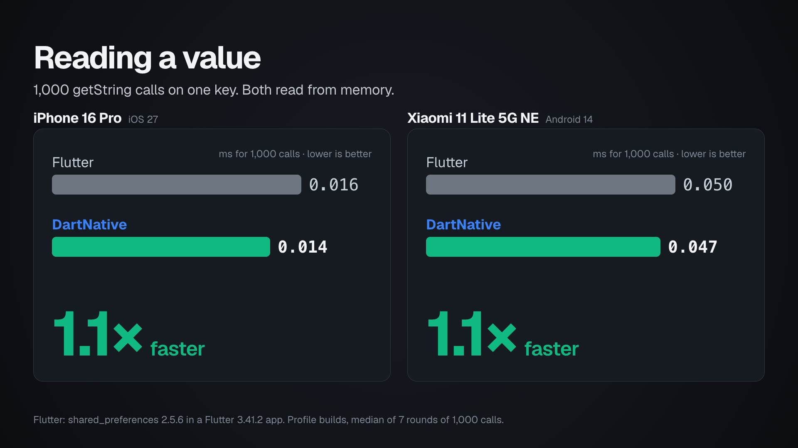

# Preferences: shared_preferences against dartnative_shared_preferences

Writing and reading values, the way apps use `SharedPreferences`:
Flutter's `shared_preferences` in a Flutter app against
`dartnative_shared_preferences` in a DartNative app, on the same phones,
both profile builds, with the same benchmark code.

**Status: measured on 2026-11-19** with `dartnative_shared_preferences`
1.1.0 and `shared_preferences` 2.5.6 on Flutter 3.41.2. Every number, the
charts and the table of every case are in the plugin example's
[`benchmarks/README.md`](../../plugins/dartnative_shared_preferences/example/benchmarks/README.md)
(iPhone) and
[`benchmarks/android.md`](../../plugins/dartnative_shared_preferences/example/benchmarks/android.md)
(Android); the raw output of every run is in [`results/`](results/).

## Results

https://github.com/user-attachments/assets/3bb22145-ccd9-4f76-8df3-d7072915febc





iPhone 16 Pro (iOS 27.2.1). Milliseconds for 1000 operations on a string;
lower is better.

| Operation | shared_preferences, Flutter (ms) | dartnative_shared_preferences (ms) | dartnative_shared_preferences |
| --- | ---: | ---: | ---: |
| Write, 1 key | 86.276 | 0.395 | 218x faster |
| Write, 1000 keys | 97.759 | 0.562 | 174x faster |
| Read, 1 key | 0.016 | 0.014 | 1.1x faster |
| Read, 1000 keys | 0.135 | 0.112 | 1.2x faster |

Xiaomi 11 Lite 5G NE (Android 14), a mid-range phone:

| Operation | shared_preferences, Flutter (ms) | dartnative_shared_preferences (ms) | dartnative_shared_preferences |
| --- | ---: | ---: | ---: |
| Write, 1 key | 767.617 | 1.538 | 499x faster |
| Write, 1000 keys | 1635.685 | 2.290 | 714x faster |
| Read, 1 key | 0.050 | 0.047 | 1.1x faster |
| Read, 1000 keys | 0.401 | 0.338 | 1.2x faster |

What a returning write guarantees is not the same on every row:

- **iPhone**: the same on both sides. The app being killed right after
  loses neither value; Flutter's is held by the system's preferences
  daemon, DartNative's by the store's memory-mapped file in the kernel's
  page cache, and each reaches storage a little later.
- **Android**: Flutter's `set` calls `commit()`, which syncs the file to
  storage before it returns, so its value also survives a power cut right
  after. DartNative's survives the app being killed and is synced within
  about a second (`reload()` syncs at once). Most of Flutter's time on
  Android is that sync.

## What is in this folder

| Path | What it is |
| --- | --- |
| [`flutter/`](flutter/) | The Flutter side: a `flutter create` app with `shared_preferences` 2.5.6 and the benchmark code. |
| [`../../plugins/dartnative_shared_preferences/example/`](../../plugins/dartnative_shared_preferences/example/) | The DartNative side: the plugin's example, whose `lib/benchmark_main.dart` runs the benchmark. |
| [`tool/sync_flutter.sh`](tool/sync_flutter.sh) | Copies the benchmark code from the example into `flutter/`, changing the two lines that differ (the import and the side's name). |
| [`tool/run_ios.sh`](tool/run_ios.sh), [`tool/run_android.sh`](tool/run_android.sh) | Install one side's build on a phone, run it, and save its table. |
| [`tool/combine.py`](tool/combine.py), [`tool/summary.py`](tool/summary.py) | Put one DartNative run beside two Flutter runs: every case, and the summary tables the charts are drawn from. |
| [`results/`](results/) | The raw tables of the runs above. |

## How it is measured

- **The same code on both sides.** `lib/benchmark/` is the example's, with
  two lines changed. Every case runs 1000 operations; two warm-up rounds,
  then the median of seven. Every write stores a value that differs from
  the one before it, since `UserDefaults` skips a write whose value is
  unchanged.
- **Profile builds on real phones**, each app launched on its own, without
  a tool attached; the table is read from the app's temporary folder (iOS)
  or the log (Android).
- **Flutter runs twice, DartNative once**, and Flutter's column is the
  better of its two runs for each row: every doubt goes Flutter's way.
- **Every case is in the tables**, with how far each side's write got when
  the clock stopped: stored writes awaited one by one, the last of 1000
  awaited, writes not awaited, and reads of each type.

## Run it on your phone

```
# DartNative side
cd plugins/dartnative_shared_preferences/example
dn build ios --profile -t lib/benchmark_main.dart     # or: dn build apk --profile -t ...
# Flutter side
cd benchmarks/shared_preferences/flutter
flutter build ios --profile                           # or: flutter build apk --profile

# iPhone: each side once, Flutter a second time
benchmarks/shared_preferences/tool/run_ios.sh <UDID> <Runner.app> <bundle id> dartnative.txt
# Android
benchmarks/shared_preferences/tool/run_android.sh <device> <app-profile.apk> <package> flutter1.txt

python3 benchmarks/shared_preferences/tool/combine.py dartnative.txt flutter1.txt flutter2.txt
```

On Android add `--stored-ratio` to `combine.py` for a ratio on stored
writes, whose guarantees differ as described above. Both apps clear the
store before every round and at the end, so run them where their own
values do not matter. Or simply run `dn run --profile -t
lib/benchmark_main.dart` in the example and read the table in the console.
