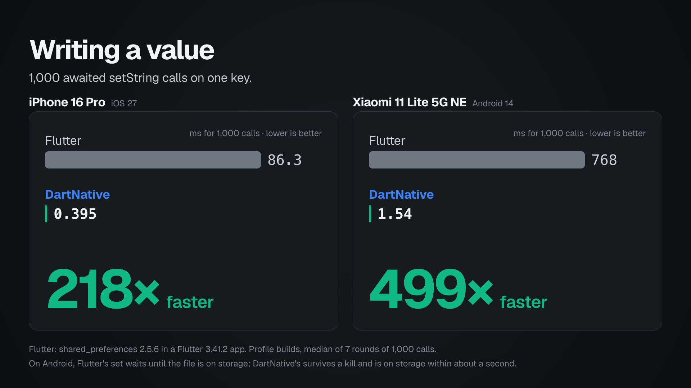
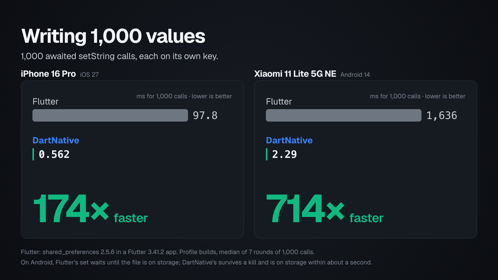
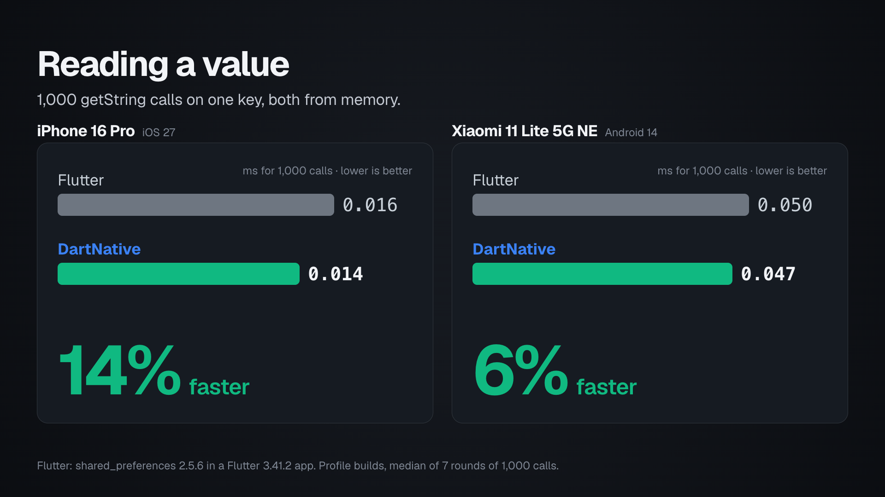
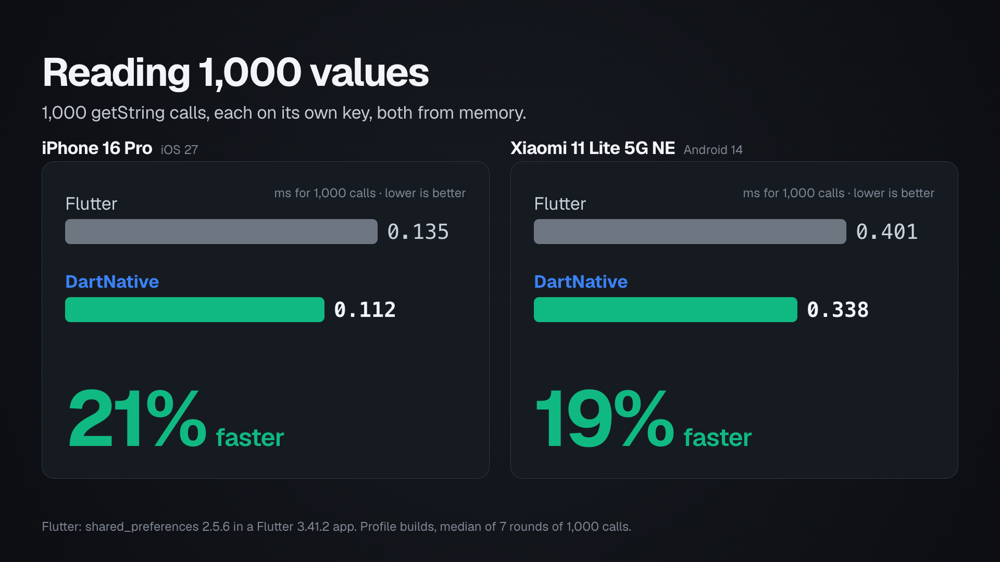

# Preferences: shared_preferences against dartnative_shared_preferences

Writing and reading values, the way apps use `SharedPreferences`:
Flutter's `shared_preferences` in a Flutter app against
`dartnative_shared_preferences` in a DartNative app, on the same phones,
both profile builds, with the same benchmark code.

**Status: measured** with `dartnative_shared_preferences`
1.1.0 and `shared_preferences` 2.5.6 on Flutter 3.41.2. Everything is in
this folder: the two apps, the scripts that run them, every case on each
phone ([`results/iphone.md`](results/iphone.md),
[`results/android.md`](results/android.md)), the raw output of every run
([`results/`](results/)) and the charts ([`charts/`](charts/)).

## Results

https://github.com/user-attachments/assets/dcfa6e79-0c1d-4921-a65b-c6cf24f9dffb









iPhone 16 Pro (iOS 27.2.1). Milliseconds for 1000 operations on a string;
lower is better.

| Operation | shared_preferences, Flutter (ms) | dartnative_shared_preferences (ms) | dartnative_shared_preferences |
| --- | ---: | ---: | ---: |
| Write, 1 key | 86.276 | 0.395 | 218x faster |
| Write, 1000 keys | 97.759 | 0.562 | 174x faster |
| Read, 1 key | 0.016 | 0.014 | 1.1x faster |
| Read, 1000 keys | 0.135 | 0.112 | 1.2x faster |

Xiaomi 11 Lite 5G NE (Android 14), a mid-range phone:

| Operation | shared_preferences, Flutter (ms) | dartnative_shared_preferences (ms) | dartnative_shared_preferences |
| --- | ---: | ---: | ---: |
| Write, 1 key | 767.617 | 1.538 | 499x faster |
| Write, 1000 keys | 1635.685 | 2.290 | 714x faster |
| Read, 1 key | 0.050 | 0.047 | 1.1x faster |
| Read, 1000 keys | 0.401 | 0.338 | 1.2x faster |

What a returning write guarantees is not the same on every row:

- **iPhone**: the same on both sides. The app being killed right after
  loses neither value; Flutter's is held by the system's preferences
  daemon, DartNative's by the store's memory-mapped file in the kernel's
  page cache, and each reaches storage a little later.
- **Android**: Flutter's `set` calls `commit()`, which syncs the file to
  storage before it returns, so its value also survives a power cut right
  after. DartNative's survives the app being killed and is synced within
  about a second (`reload()` syncs at once). Most of Flutter's time on
  Android is that sync.

## What is in this folder

| Path | What it is |
| --- | --- |
| [`dartnative/`](dartnative/) | The DartNative side: a `dn create` app with `dartnative_shared_preferences` 1.1.0. [`lib/benchmark/`](dartnative/lib/benchmark/) is the benchmark code: the cases (`prefs_cases.dart`), the timing and the median (`benchmark_runner.dart`, `benchmark_types.dart`). |
| [`flutter/`](flutter/) | The Flutter side: a `flutter create` app with `shared_preferences` 2.5.6 and the same benchmark code, two lines changed (the import and the side's name). |
| [`results/`](results/) | [`iphone.md`](results/iphone.md) and [`android.md`](results/android.md), every case on each phone, and the raw tables of every run. |
| [`charts/`](charts/) | The four charts and the reel. |
| [`chart.py`](chart.py) | Draws a chart from the tables of `results/iphone.md` and `results/android.md`. |
| [`tool/sync_flutter.sh`](tool/sync_flutter.sh) | Copies the benchmark code from `dartnative/` into `flutter/`, changing the two lines that differ. |
| [`tool/run_ios.sh`](tool/run_ios.sh), [`tool/run_android.sh`](tool/run_android.sh) | Install one side's build on a phone, run it, and save its table. |
| [`tool/combine.py`](tool/combine.py), [`tool/summary.py`](tool/summary.py) | Put one DartNative run beside two Flutter runs: every case, and the summary tables the charts are drawn from. |

## How it is measured

- **The same code on both sides.** [`lib/benchmark/`](dartnative/lib/benchmark/)
  is the same in both apps, with two lines changed. Every case runs 1000
  operations; two warm-up rounds, then the median of seven. Every write
  stores a value that differs from the one before it, since `UserDefaults`
  skips a write whose value is unchanged.
- **Profile builds on real phones**, each app launched on its own, without
  a tool attached; the table is read from the app's temporary folder (iOS)
  or the log (Android).
- **Flutter runs twice, DartNative once**, and Flutter's column is the
  better of its two runs for each row: every doubt goes Flutter's way.
- **Every case is in the tables**, with how far each side's write got when
  the clock stopped: stored writes awaited one by one, the last of 1000
  awaited, writes not awaited, and reads of each type.

## Run it on your phone

From this folder:

```
# DartNative side
cd dartnative && dn build ios --profile && cd ..     # or: dn build apk --profile
# Flutter side
cd flutter && flutter build ios --profile && cd ..   # or: flutter build apk --profile

# iPhone: each side once, Flutter a second time
tool/run_ios.sh <UDID> <Runner.app> <bundle id> dartnative.txt
# Android
tool/run_android.sh <device> <app-profile.apk> <package> flutter1.txt

python3 tool/combine.py dartnative.txt flutter1.txt flutter2.txt
```

On Android add `--stored-ratio` to `combine.py` for a ratio on stored
writes, whose guarantees differ as described above. Both apps clear the
store before every round and at the end. Or simply run `dn run --profile`
in `dartnative/` and read the table in the console.

## Redrawing the charts

The charts are drawn from the tables of `results/iphone.md` and
`results/android.md`, so they cannot drift from the numbers. From this
folder, with Google Chrome installed:

```
F1="Flutter: shared_preferences 2.5.6 in a Flutter 3.41.2 app. Profile builds, median of 7 rounds of 1,000 calls."
F2="On Android, Flutter's set waits until the file is on storage; DartNative's survives a kill and is on storage within about a second."
python3 chart.py charts/write_one_key.png "Write, 1 key" "Writing a value" \
  "1,000 awaited setString calls on one key." faster --footer "$F1\n$F2"
python3 chart.py charts/write_1000_keys.png "Write, 1000 keys" "Writing 1,000 values" \
  "1,000 awaited setString calls, each on its own key." faster --footer "$F1\n$F2"
python3 chart.py charts/read_one_key.png "Read, 1 key" "Reading a value" \
  "1,000 getString calls on one key, both from memory." faster --footer "$F1"
python3 chart.py charts/read_1000_keys.png "Read, 1000 keys" "Reading 1,000 values" \
  "1,000 getString calls, each on its own key, both from memory." faster --footer "$F1"
```

Each is 1920 x 1080, in the look of this repository's other benchmarks.
The gain is Flutter's time over DartNative's: from 2× up, "N× faster", as
those benchmarks write it; under 2×, a percentage ("21% faster" for
1.21×), since "1.2× faster" reads as if it were 120%.
