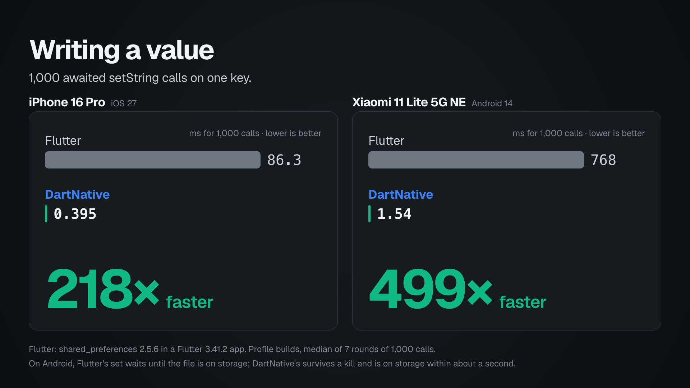
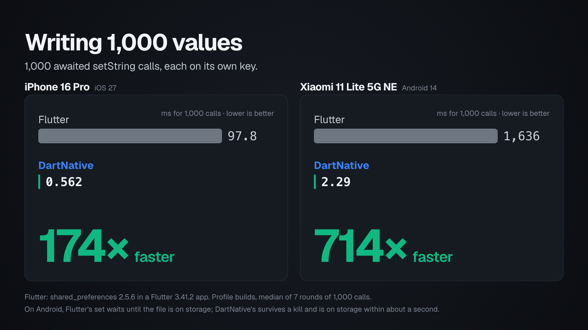
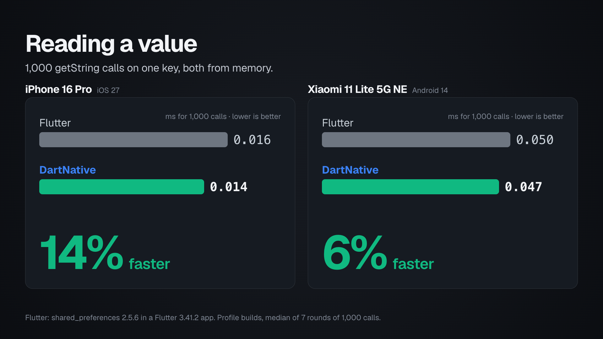
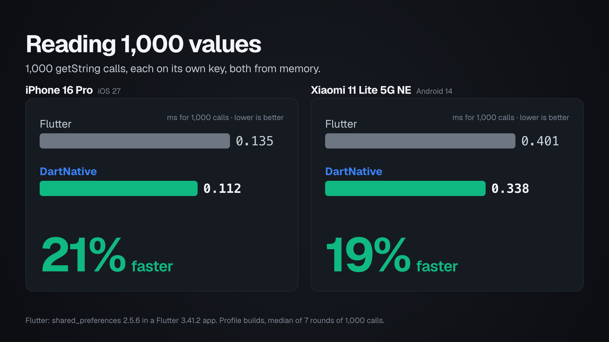

# dartnative_shared_preferences

Simple key–value preferences for DartNative, with the familiar `shared_preferences` API, kept
in a fast memory-mapped store of its own. iOS and Android.

## Why you'll like it

- **Familiar API** — `getInstance()`, then `getString` / `setBool` / …, like `shared_preferences`.
- **All the common types** — `String`, `int`, `double`, `bool`, `List<String>`.
- **Works from any isolate** — no platform channel, so reads and writes work outside the main isolate,
  background tasks included, and a value one of them writes is seen by every other on its next read.
- **Fast writes** — a write takes about a microsecond, hundreds of times faster than Flutter's
  ([iPhone](https://github.com/DartNative/dartnative/blob/main/benchmarks/shared_preferences/results/iphone.md), [Android](https://github.com/DartNative/dartnative/blob/main/benchmarks/shared_preferences/results/android.md)), and is
  kept even if the app is killed right after.
- **Fast reads** — as fast as Flutter's: each isolate reads from memory and still sees other isolates' writes.
- **Safe counters** — `incrementInt` and the `updateX` methods change a value atomically across isolates.
- **Zero setup** — nothing to configure on either platform.
- **Keeps what your Flutter app saved** — an app updated from its Flutter build reads the values Flutter's `shared_preferences` stored.

## Highlights

- **`SharedPreferences.getInstance()`** → the store.
- **`getString` / `getInt` / `getDouble` / `getBool` / `getStringList`** (+ `containsKey`).
- **`setString` / `setInt` / `setDouble` / `setBool` / `setStringList`**, plus `remove` / `clear` / `reload`.
- **`incrementInt` / `updateInt` / `updateDouble` / `updateBool` / `updateString` / `updateStringList`** — atomic
  read-modify-write, for a counter or a list that several isolates or background tasks change.

> `getKeys()` (enumerate all keys) isn't available yet.

## Install

```yaml
dependencies:
  dartnative_shared_preferences: ^1.1.0   # from dartpub.dev
```

```bash
dn pub get
```

```dart
void main() {
  DartNativePluginRegistrant.registerAll();
  runApp(const MyApp());
}
```

## Quick look

```dart
import 'package:dartnative_shared_preferences/dartnative_shared_preferences.dart';

final prefs = await SharedPreferences.getInstance();

await prefs.setString('name', 'Ada');
await prefs.setBool('onboarded', true);

final name = prefs.getString('name');     // 'Ada'
final done = prefs.getBool('onboarded');  // true
```

## Background tasks and isolates

Every isolate of the app — the UI isolate, `Isolate.run` workers, a background task — uses the
same store, and a value one of them writes is seen by every other on its next read, with no
`reload()`. When several of them change the same value, use the atomic updates: a `getInt`
followed by a `setInt` from two isolates at once can lose one of the two changes.

```dart
await prefs.incrementInt('syncs');                              // a counter
await prefs.updateStringList('log', (l) => [...?l, 'synced']);  // an append
```

The function given to an `updateX` may run more than once, when another isolate changed the
value in between, so it should only compute the new value.

## Coming from Flutter

When your DartNative app ships as an update to a Flutter app with the same app
id, the first `getInstance()` brings over what Flutter's `shared_preferences`
saved, each value with its type: settings, flags, a user id, anything the app
kept there. It happens once; a value you remove afterwards stays removed, and
Flutter's copy is left in place so the Flutter build still works if you roll
back.

If your Flutter app called `SharedPreferences.setPrefix`, keep the call: it
tells the plugin where Flutter saved.

```dart
SharedPreferences.setPrefix('myapp.');          // before getInstance()
final prefs = await SharedPreferences.getInstance();
```

What `SharedPreferencesAsync` saved is brought over on Android. On iOS it
saved its keys without a prefix, among the app's other settings, so they come
over only when named; for an app that used only that API:
`SharedPreferences.setPrefix('', allowList: {'token', 'onboarded'})`.

## Platform setup

### iOS

No native setup required.

### Android

No native setup required.

## Fast, safe writes

Values are kept in a memory-mapped file, a mechanism built into iOS and Android: the file's
contents sit in memory that belongs to the operating system, not to the app, and the system
writes them to storage itself. A `setX` copies the value there before it returns. From that
moment the value is safe: nothing is lost if the app crashes, is closed from the app switcher,
or is suspended or stopped by the system. The store writes it to storage within about a
second, and at once when the app goes to the background.

The one event the system cannot cover is a sudden loss of power before the data is on
storage, which can lose the last second of writes. When a value must survive even that, call
`reload()` after the write: it returns once everything is on the device's storage, in a few
milliseconds.

Reads are a lookup in memory: 1,000 `getString` calls are 6% to 21% faster than Flutter's.

On an iPhone 16 Pro, 1,000 awaited `setString` calls take 0.40 ms, against 86 ms for
`shared_preferences` in a Flutter app on the same phone: 218 times faster. On a mid-range
Android phone, writes are 499 to 1,706 times faster; there, Flutter's plugin syncs every
write to storage before it returns, which this plugin does within about a second, or at once
on `reload()`.

https://github.com/user-attachments/assets/dcfa6e79-0c1d-4921-a65b-c6cf24f9dffb









The benchmark is open source: the DartNative app and the Flutter app it was
measured with, every number, and the scripts to run both on your own phone
are in the DartNative repository's
[`benchmarks/shared_preferences/`](https://github.com/DartNative/dartnative/tree/main/benchmarks/shared_preferences).

## Example

The [`example/`](./example) app stores and reads a few settings — borrow from it freely.

## Credits & license

API mirrors Flutter's
[`shared_preferences`](https://github.com/flutter/packages/tree/main/packages/shared_preferences)
(BSD-3-Clause); the plugin ships its own native code over FFI — a
memory-mapped store in C, the same on both platforms — built on the
DartNative framework's runtime (FFI loader, and the Android application
context).

First-party DartNative plugin, free to use in any DartNative app. Distributed
through [dartpub.dev](https://dartpub.dev); report issues on the plugin's page.
