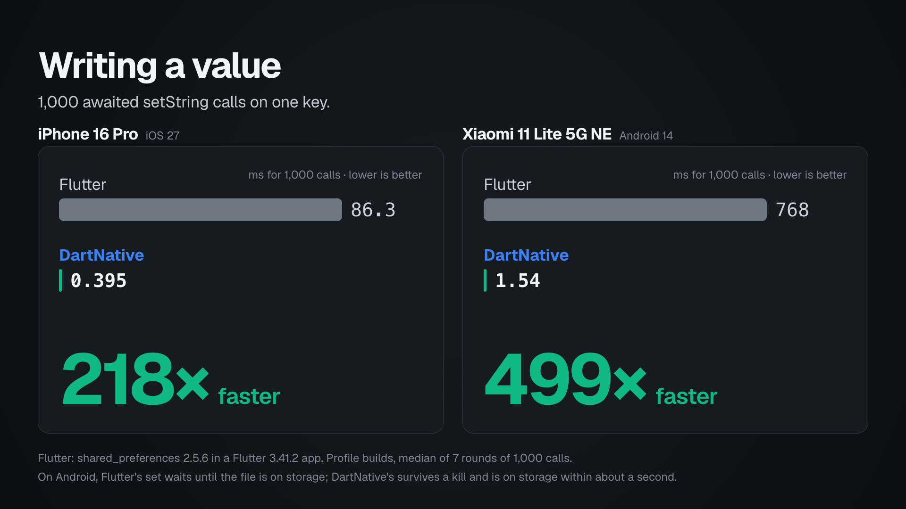
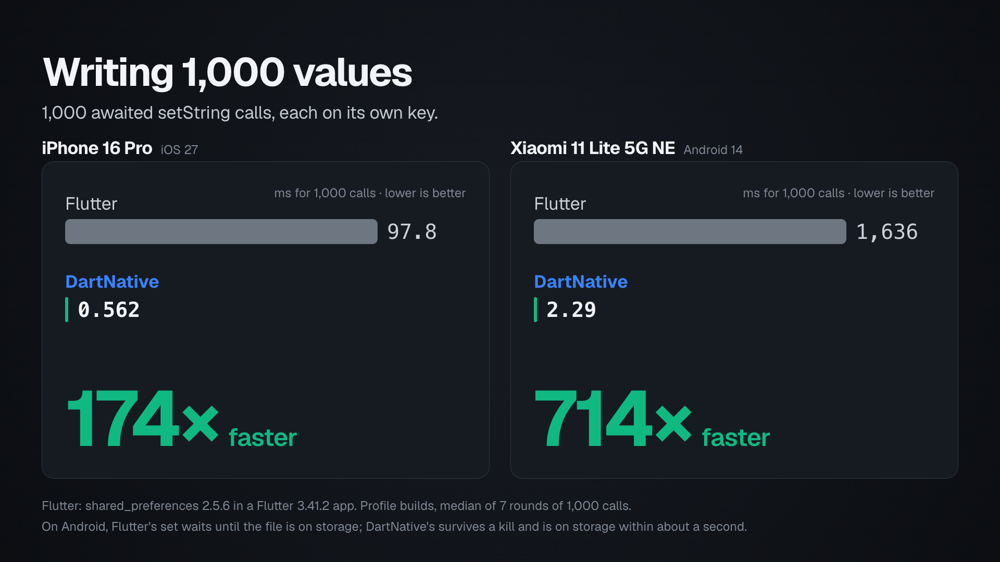
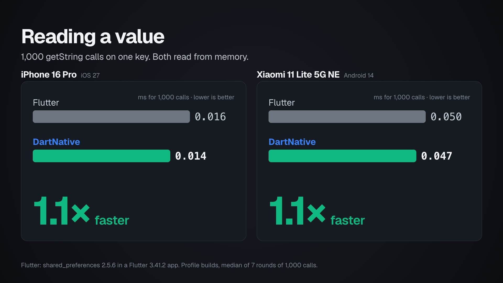
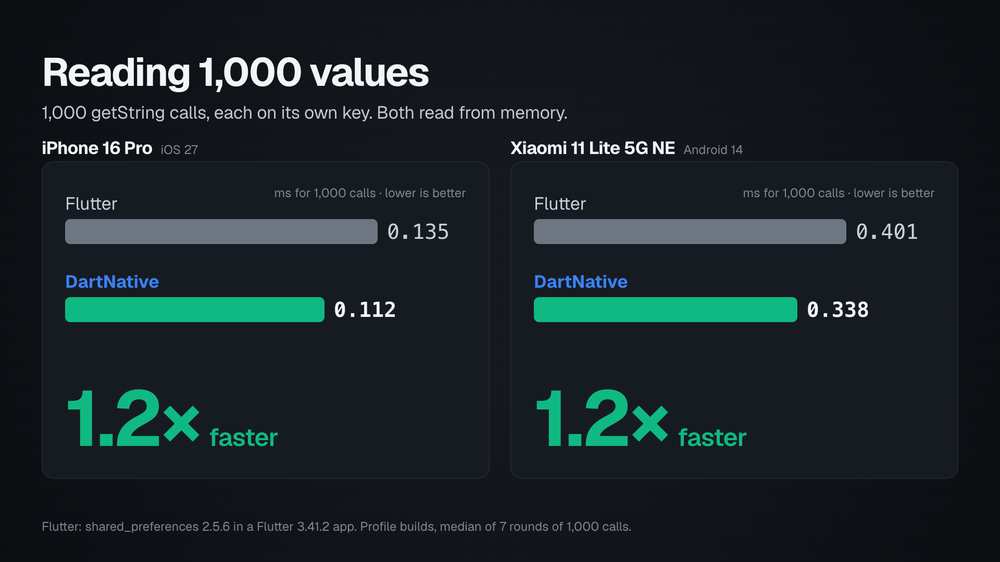

# Benchmark

Flutter's `shared_preferences` in a Flutter app against
`dartnative_shared_preferences` in a DartNative app, on the same iPhone 16
Pro (iOS 27.2.1), both profile builds, 1000 operations per case, two
warm-up rounds, median of seven. Measured on 2026-11-19 with 1.1.0, whose
store is the plugin's own memory-mapped file; Flutter's column is from the
same day. The Android phone: [android.md](android.md).

How each side runs:

- **dartnative_shared_preferences**: this example,
  `dn run --profile -t lib/benchmark_main.dart`. (For the table below the
  same files ran in a scratch app that compiles the 1.1.0 facade itself,
  launched without the tool attached: the SDK's baked module was older, and
  the tool's connection to the phone dropped mid-run. It ran twice; the two
  runs were within 20% of each other on every row, and the table has the
  first.)
- **shared_preferences, Flutter**: a new `flutter create` app with
  `shared_preferences: ^2.5.6` (legacy `SharedPreferences` API, the one this
  plugin mirrors), the files of `lib/benchmark/` copied in with two lines
  changed (the import, and `benchmarkSide = 'flutter'`), built with
  `flutter build ios --profile` on stock Flutter 3.41.2 and launched without
  the tool attached (the tool's USB port forwarding failed on this iOS). It
  ran twice, and its column is the better of the two runs for each row, the
  one that favours Flutter.

Every write stores a value that differs from the one before it:
`UserDefaults` skips a write whose value is unchanged, which would time
nothing.

## Writes and reads









The same results as a 29-second reel with music (also in this folder,
[`shared_preferences_reel.mp4`](shared_preferences_reel.mp4)):

https://github.com/user-attachments/assets/3bb22145-ccd9-4f76-8df3-d7072915febc

Milliseconds for 1000 operations on a string; lower is better.

| Operation | shared_preferences, Flutter (ms) | dartnative_shared_preferences (ms) | dartnative_shared_preferences |
| --- | ---: | ---: | ---: |
| Write, 1 key | 86.276 | 0.395 | 218x faster |
| Write, 1000 keys | 97.759 | 0.562 | 174x faster |
| Read, 1 key | 0.016 | 0.014 | 1.1x faster |
| Read, 1000 keys | 0.135 | 0.112 | 1.2x faster |

- **Write**: 1000 awaited `setString` calls, on one key or on 1000 keys.
  Each has stored the value when it returns, on both sides: the app being
  killed right after loses nothing.
- **Read**: 1000 `getString` calls, on one key or on 1000 keys, all of
  them set before the clock starts.

## Writes by type

Milliseconds for 1000 awaited sets on one key; lower is better.

| Type | shared_preferences, Flutter (ms) | dartnative_shared_preferences (ms) | dartnative_shared_preferences |
| --- | ---: | ---: | ---: |
| string | 86.276 | 0.395 | 218x faster |
| integer | 81.674 | 0.203 | 402x faster |
| double | 82.517 | 0.271 | 304x faster |
| boolean | 101.835 | 0.202 | 504x faster |
| string list | 83.778 | 0.362 | 231x faster |

<details>
<summary>Every case: 1000 keys, sets not awaited, the last of 1000 awaited, reads of every type</summary>

Milliseconds for 1000 operations; lower is better. A ratio is given only
where both sides' writes got equally far (see the durability column and
`lib/benchmark/benchmark_types.dart`).

| Case | Flutter (ms) | DartNative (ms) | DartNative | Durability, Flutter / DartNative |
| --- | ---: | ---: | ---: | --- |
| **Stored writes** | | | | |
| string, every set awaited | 86.276 | 0.395 | 218x faster | userDefaults / mapped |
| string, every set awaited, 1000 keys | 97.759 | 0.562 | 174x faster | userDefaults / mapped |
| string, 1000 sets, last awaited | 74.312 | 0.269 | 276x faster | userDefaults / mapped |
| integer, every set awaited | 81.674 | 0.203 | 402x faster | userDefaults / mapped |
| integer, every set awaited, 1000 keys | 107.612 | 0.327 | 329x faster | userDefaults / mapped |
| integer, 1000 sets, last awaited | 75.377 | 0.135 | 558x faster | userDefaults / mapped |
| double, every set awaited | 82.517 | 0.271 | 304x faster | userDefaults / mapped |
| double, every set awaited, 1000 keys | 111.290 | 0.407 | 273x faster | userDefaults / mapped |
| double, 1000 sets, last awaited | 101.818 | 0.208 | 490x faster | userDefaults / mapped |
| boolean, every set awaited | 101.835 | 0.202 | 504x faster | userDefaults / mapped |
| boolean, every set awaited, 1000 keys | 106.693 | 0.334 | 319x faster | userDefaults / mapped |
| boolean, 1000 sets, last awaited | 73.577 | 0.134 | 549x faster | userDefaults / mapped |
| string list, every set awaited | 83.778 | 0.362 | 231x faster | userDefaults / mapped |
| string list, every set awaited, 1000 keys | 105.486 | 0.509 | 207x faster | userDefaults / mapped |
| string list, 1000 sets, last awaited | 93.618 | 0.294 | 318x faster | userDefaults / mapped |
| **Writes not awaited** | | | | |
| string, set not awaited | 1.165 | 0.282 |  | inProcess / mapped |
| string, set not awaited, 1000 keys | 1.259 | 0.490 |  | inProcess / mapped |
| integer, set not awaited | 0.989 | 0.158 |  | inProcess / mapped |
| integer, set not awaited, 1000 keys | 1.105 | 0.274 |  | inProcess / mapped |
| double, set not awaited | 1.062 | 0.205 |  | inProcess / mapped |
| double, set not awaited, 1000 keys | 1.138 | 0.338 |  | inProcess / mapped |
| boolean, set not awaited | 1.087 | 0.133 |  | inProcess / mapped |
| boolean, set not awaited, 1000 keys | 1.167 | 0.274 |  | inProcess / mapped |
| string list, set not awaited | 1.234 | 0.308 |  | inProcess / mapped |
| string list, set not awaited, 1000 keys | 1.420 | 0.490 |  | inProcess / mapped |
| **Reads** | | | | |
| string read | 0.016 | 0.014 | 1.1x faster | read |
| string read, 1000 keys | 0.135 | 0.112 | 1.2x faster | read |
| integer read | 0.012 | 0.012 | same | read |
| integer read, 1000 keys | 0.079 | 0.077 | same | read |
| double read | 0.014 | 0.014 | same | read |
| double read, 1000 keys | 0.093 | 0.094 | same | read |
| boolean read | 0.012 | 0.014 | 1.2x slower | read |
| boolean read, 1000 keys | 0.084 | 0.083 | same | read |
| string list read | 0.093 | 0.052 | 1.8x faster | read |
| string list read, 1000 keys | 0.224 | 0.221 | same | read |

</details>

What it says:

- **Stored writes are 170 to 560 times faster.** Flutter's awaited `set`
  waits for `UserDefaults.set`, 74 to 112 µs on this phone. DartNative's
  appends a record to its memory-mapped store and returns: 0.13 to 0.56 µs.
  The two got equally far when they return (`mapped` and `userDefaults` in
  `benchmark_types.dart`): the app being killed or crashing right after
  loses neither value, and each reaches storage a little later, written by
  the preferences daemon for Flutter and by the store's own thread, within
  about a second, for DartNative.
- **Writes not awaited** do different work, so they get no ratio, but even
  here DartNative is 2.6 to 8 times faster: Flutter's `set` returns once its
  Dart map is updated and the platform channel message is queued, with
  nothing stored; DartNative's has stored the value when it returns, which
  is what a background task that is suspended right after it needs.
- **Reads are as fast as Flutter's**, within 1.2x either way, and a string
  list read 1.8x faster (the decoded list is kept). Each isolate reads
  through its own cache, checked against a version counter the whole
  process shares, so a value written by another isolate or a background
  task is still seen on the next read, with no `reload()`.
- **Before 1.1.0** every read was an FFI call into `UserDefaults`, 5 to 44
  times slower than Flutter's (0.47 to 1.10 ms per 1000), and every write
  was a `UserDefaults.set`, as fast as Flutter's and no faster.

## Redrawing the charts

The charts are drawn from the tables of this page (the iPhone) and of
[android.md](android.md) (the Android phone), so they cannot drift from the
numbers. In this folder, with Google Chrome installed:

```
F1="Flutter: shared_preferences 2.5.6 in a Flutter 3.41.2 app. Profile builds, median of 7 rounds of 1,000 calls."
F2="On Android, Flutter's set waits until the file is on storage; DartNative's survives a kill and is on storage within about a second."
python3 chart.py write_one_key.png "Write, 1 key" "Writing a value" \
  "1,000 awaited setString calls on one key." faster --footer "$F1\n$F2"
python3 chart.py write_1000_keys.png "Write, 1000 keys" "Writing 1,000 values" \
  "1,000 awaited setString calls, each on its own key." faster --footer "$F1\n$F2"
python3 chart.py read_one_key.png "Read, 1 key" "Reading a value" \
  "1,000 getString calls on one key. Both read from memory." faster --footer "$F1"
python3 chart.py read_1000_keys.png "Read, 1000 keys" "Reading 1,000 values" \
  "1,000 getString calls, each on its own key. Both read from memory." faster --footer "$F1"
```

Each is 1920 x 1080, in the look of the DartNative repository's other
benchmarks.
