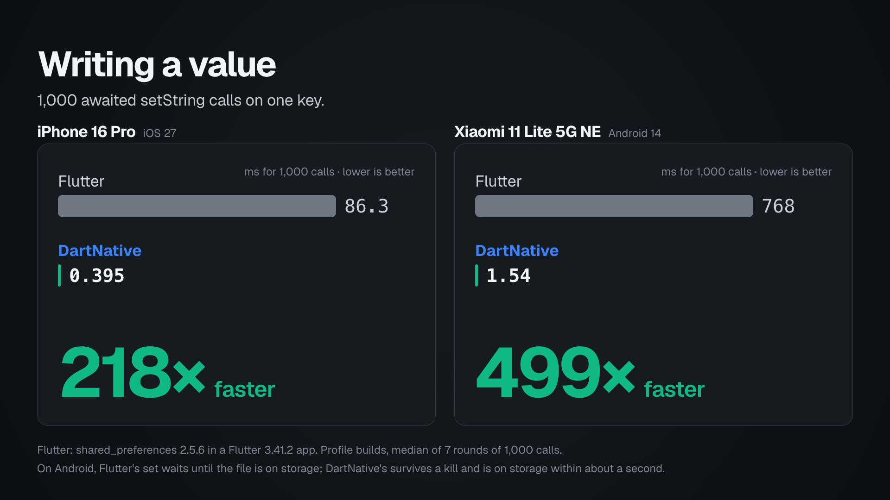
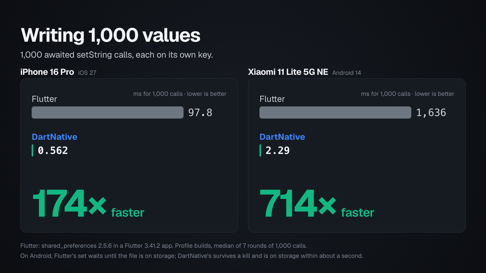
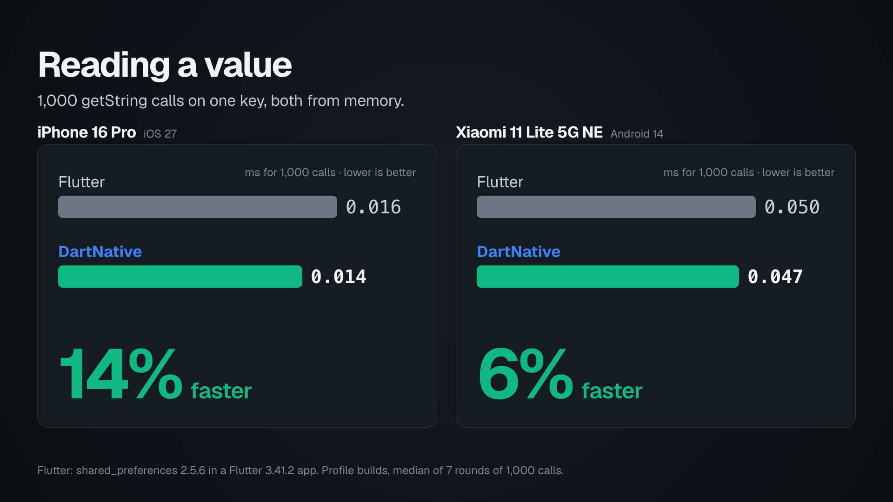
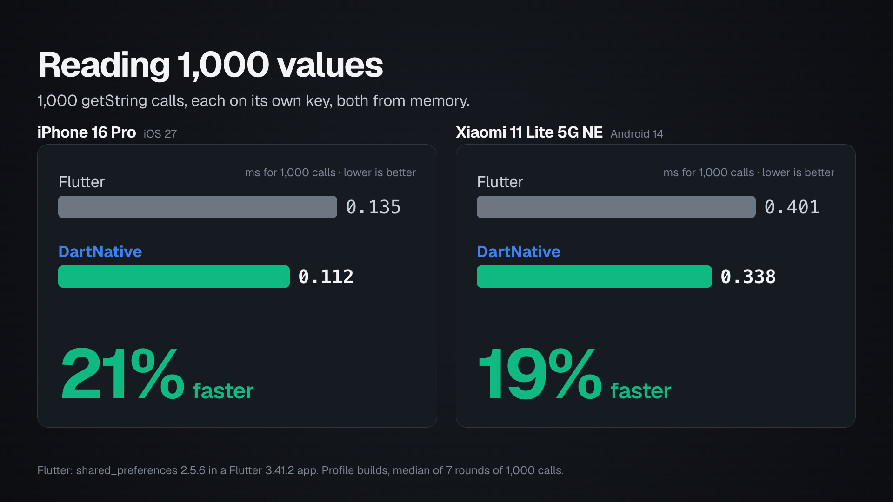

# Benchmark on Android

Flutter's `shared_preferences` in a Flutter app against
`dartnative_shared_preferences` in a DartNative app, on the same mid-range
Android phone, the Xiaomi 11 Lite 5G NE (Android 14), both profile builds,
1000 operations per case, two warm-up rounds, median of seven. Measured on
2026-11-19 with 1.1.0, whose store is the plugin's own memory-mapped
file. Run the way the iPhone's was ([README.md](README.md)):
the same files of `lib/benchmark/` in both apps, two lines changed;
DartNative once, Flutter twice, Flutter's column the better of its two runs
for each row. A second DartNative run was within 14% of the first at the
median and 47% at most; the table has the first.

**The two sides' writes do not get equally far on Android.** Flutter's
legacy `SharedPreferences` calls `commit()`, which writes the whole XML file
and syncs it to storage before the `set` returns: the value survives a
power cut right after. DartNative's `set` returns once the value is in the
store's memory-mapped file, the kernel's page cache: the app being killed or
crashing right after loses nothing, and the store's thread writes it to
storage within about a second; a power cut in that second can lose it.
`reload()` syncs at once. The ratios below compare the two as each plugin
ships; most of Flutter's time is that sync. On the iPhone both sides stop at
the same point ([README.md](README.md)).

## Writes and reads

Milliseconds for 1000 operations on a string; lower is better.

| Operation | shared_preferences, Flutter (ms) | dartnative_shared_preferences (ms) | dartnative_shared_preferences |
| --- | ---: | ---: | ---: |
| Write, 1 key | 767.617 | 1.538 | 499x faster |
| Write, 1000 keys | 1635.685 | 2.290 | 714x faster |
| Read, 1 key | 0.050 | 0.047 | 1.1x faster |
| Read, 1000 keys | 0.401 | 0.338 | 1.2x faster |

## Writes by type

Milliseconds for 1000 awaited sets on one key; lower is better.

| Type | shared_preferences, Flutter (ms) | dartnative_shared_preferences (ms) | dartnative_shared_preferences |
| --- | ---: | ---: | ---: |
| string | 767.617 | 1.538 | 499x faster |
| integer | 786.448 | 0.658 | 1195x faster |
| double | 788.642 | 1.015 | 777x faster |
| boolean | 770.344 | 0.560 | 1376x faster |
| string list | 897.333 | 1.280 | 701x faster |

Every case: 1000 keys, sets not awaited, the last of 1000 awaited, reads of every type

Milliseconds for 1000 operations; lower is better. The durability column
says how far each side's writes got (`lib/benchmark/benchmark_types.dart`).

| Case | Flutter (ms) | DartNative (ms) | DartNative | Durability, Flutter / DartNative |
| --- | ---: | ---: | ---: | --- |
| **Stored writes** | | | | |
| string, every set awaited | 767.617 | 1.538 | 499x faster | committed / mapped |
| string, every set awaited, 1000 keys | 1635.685 | 2.290 | 714x faster | committed / mapped |
| string, 1000 sets, last awaited | 681.666 | 0.938 | 727x faster | committed / mapped |
| integer, every set awaited | 786.448 | 0.658 | 1195x faster | committed / mapped |
| integer, every set awaited, 1000 keys | 1568.192 | 1.129 | 1389x faster | committed / mapped |
| integer, 1000 sets, last awaited | 695.296 | 0.535 | 1300x faster | committed / mapped |
| double, every set awaited | 788.642 | 1.015 | 777x faster | committed / mapped |
| double, every set awaited, 1000 keys | 1614.557 | 1.522 | 1061x faster | committed / mapped |
| double, 1000 sets, last awaited | 697.057 | 0.765 | 911x faster | committed / mapped |
| boolean, every set awaited | 770.344 | 0.560 | 1376x faster | committed / mapped |
| boolean, every set awaited, 1000 keys | 1430.389 | 0.976 | 1466x faster | committed / mapped |
| boolean, 1000 sets, last awaited | 776.250 | 0.455 | 1706x faster | committed / mapped |
| string list, every set awaited | 897.333 | 1.280 | 701x faster | committed / mapped |
| string list, every set awaited, 1000 keys | 2274.426 | 1.665 | 1366x faster | committed / mapped |
| string list, 1000 sets, last awaited | 793.792 | 1.155 | 687x faster | committed / mapped |
| **Writes not awaited** | | | | |
| string, set not awaited | 41.458 | 0.879 |  | inProcess / mapped |
| string, set not awaited, 1000 keys | 52.666 | 1.123 |  | inProcess / mapped |
| integer, set not awaited | 38.845 | 0.456 |  | inProcess / mapped |
| integer, set not awaited, 1000 keys | 42.153 | 0.813 |  | inProcess / mapped |
| double, set not awaited | 44.081 | 0.753 |  | inProcess / mapped |
| double, set not awaited, 1000 keys | 40.881 | 1.114 |  | inProcess / mapped |
| boolean, set not awaited | 39.043 | 0.443 |  | inProcess / mapped |
| boolean, set not awaited, 1000 keys | 42.453 | 0.839 |  | inProcess / mapped |
| string list, set not awaited | 54.545 | 1.163 |  | inProcess / mapped |
| string list, set not awaited, 1000 keys | 64.953 | 1.524 |  | inProcess / mapped |
| **Reads** | | | | |
| string read | 0.050 | 0.047 | 1.1x faster | read |
| string read, 1000 keys | 0.401 | 0.338 | 1.2x faster | read |
| integer read | 0.036 | 0.040 | 1.1x slower | read |
| integer read, 1000 keys | 0.229 | 0.203 | 1.1x faster | read |
| double read | 0.043 | 0.045 | same | read |
| double read, 1000 keys | 0.245 | 0.248 | same | read |
| boolean read | 0.042 | 0.044 | same | read |
| boolean read, 1000 keys | 0.254 | 0.215 | 1.2x faster | read |
| string list read | 0.276 | 0.172 | 1.6x faster | read |
| string list read, 1000 keys | 0.588 | 0.667 | 1.1x slower | read |

What it says:

- **Stored writes are 500 to 1,700 times faster**: 0.46 to 2.3 µs a write
  against Flutter's 0.68 to 2.3 ms, with the difference in what a returning
  write guarantees described above.
- **Writes not awaited** get no ratio, since Flutter's has stored nothing
  when it returns, but even here DartNative is 37 to 88 times faster:
  Flutter's unawaited `set` costs 39 to 65 µs on this phone, its platform
  channel message; DartNative's has stored the value.
- **Reads are as fast as Flutter's**, within 1.2x either way, and a string
  list read 1.6x faster.

## Redrawing the charts

The charts show both phones; [README.md](README.md) has the commands that
redraw them from the tables.
